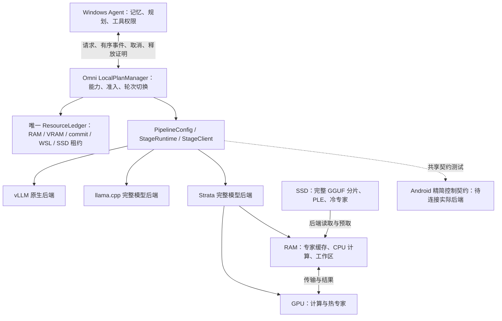

# Omni 本地推理引擎：Strata 集成状态与路线图（2026-10-10）

2026-10-21 **首个真实 CUDA 图像编码完成，但数值对照失败，禁止晋级**：四分片、投影与运行包重新哈希通过；GPU 身份为本机 64:00.0，预热 1521 tokens 后 READY，792×2560 图像嵌入成功输出，启动约 3.45 s、编码往返约 0.328 s（单样本组件值）。与已审计 CPU 参考 relative L2 **1.6611**、cosine **0.1081**，不是可接受的数值等价或 Agent 提速证明。前一尝试因脚本误要求动态 cudart DLL 停止，修正为实际 PE 必需依赖后完成；两次日志与 profiling 保留。下一步核对同二进制 CPU 与 GPU flash-attention off，定位差异。[真实输出、失败及资源证据](results/strata_20261008/strata_cuda_first_real_20261021.json)。

2026-10-21 **Windows CUDA 视觉 v1／v2 构建均 EXIT 0，profiling 已闭合**：v2 包含设备身份、预热失败处理及显式 tensor 预算检查，固定源码／工具／产物与日志哈希保留。CUDA 13.4 cublasLt 约 470 MiB 超过旧 256 MiB PE 上限，扫描器保留默认值并增加最多 1 GiB 的显式参数，非默认上限纳入 closure identity；9 项 PE 测试通过。候选使用显式 512 MiB 扫描，正常／延迟导入闭合通过；动态 cublasLt 等加载仍待真实进程核验。当前只是编译与静态依赖验证，尚无 GPU 图像数值或 Agent 性能结果。[构建、原始日志、profiling 与依赖记录](results/strata_20261008/strata_cuda_vision_builds_20261021.json)。

2026-10-21 **SVE 数值对照工具与 CPU 参考已准备**：新比较器拒绝非法形状／长度、超大小及 NaN／Inf，输出哈希、绝对误差、RMSE、relative L2 和 cosine，不自动授予质量资格。5 项测试通过；既有已审计 CPU 生命周期中的初次／恢复输出均为 792×2560，共 2,027,520 个数值，张量完全一致，原文件哈希与 receipt 匹配。这不是 CUDA 对照结果；待候选构建后使用同输入比较。[工具验证及 CPU 参考](results/strata_20261008/strata_sve_comparator_20261021.json)。

2026-10-21 **真实 ggml 集成测试修正了预算候选的分配顺序**：初次链接缺 advapi32，补齐后真实 CPU graph 测试触发访问异常（3221225477）；此前 15 项假接口测试不足以证明真实调度器正确。候选现改为测量／预算通过后 reserve 实际 buffer，再 reset／alloc。16、1024、64 元素的真实加法结果与扩容／复用检查通过，三次零预算拒绝通过；Windows 语法检查及 15 项组件回归通过。保留两次失败与修正后源码／日志／库哈希。此结果仍非 CUDA 模型或内存资格，生产 gate 关闭。[失败及修正后的真实 ggml 证据](results/strata_20261008/strata_cuda_budget_real_v2_20261021.json)。

2026-10-21 **CUDA 显式张量预算候选已实现，15 项组件测试通过**：在权重分配前复用 ggml aligned size，在预热 reserve 与每次图像 alloc_graph 前复用 scheduler reserve_size，按 GPU／主机池检查权重和 retained／planned 计算 buffer 的保守上界；缺预算、非法数字、溢出和任一池超限均拒绝。Windows MSVC 语法检查及 15 项假 ggml 故障注入通过，原始日志与测试源码归档。范围仅显式 ggml tensor buffer；CUDA context／库内部开销、host preprocessing 仍需共享账本独立准入。尚未链接或运行真实 GPU，也未改生产 gate。[补丁、语法与边界证据](results/strata_20261008/strata_cuda_tensor_budget_20261021.json)。

2026-10-21 **GPU 预热候选的 Windows 原生故障注入 11/11 通过**：从候选源码原样提取预热代码块，以假的 mtmd 接口注入 bitmap／chunk 分配失败、tokenize／encode 失败、零 token、超界、缺图像和多图像；失败均在 READY 之前返回并释放上下文，正常与恰好上限路径通过。保存 C++ 测试源码、编译／执行原始日志及哈希。这是控制流组件验证，未执行真实 CUDA／模型，也不证明显存预算约束；独立 CUDA 构建及进程 profiling 仍在运行。[11 项结果与原始证据](results/strata_20261008/strata_cuda_warmup_fault_20261021.json)。

2026-10-21 **GPU 视觉预热失败处理候选已修补，尚未集成**：发现固定原生代码在预热失败／零 image token 时仍可能发出 READY；候选改为要求恰好一个有效图像 chunk、编码成功且 token 不超过显式上限，失败释放上下文并退出，成功输出版本化预热耗时与形状记录。固定源码 apply 检查和 Windows MSVC C++17 语法检查 EXIT 0；尚未链接／故障注入或神经验证，不能当作显存预算已验证。前一版设备身份 CUDA 构建仍独立运行，未改动其源码；已附加每秒进程 profiling，挂接前缺口单独记录。[候选哈希、检查及剩余项](results/strata_20261008/strata_cuda_vision_warmup_candidate_20261021.json)。

2026-10-21 **CUDA 视觉身份候选补丁已实现，尚未集成**：从实际 ggml primary backend 读取 PCI 身份，与 `OMNI_VISION_EXPECTED_PCI_BUS_ID` 规范化比较；GPU 请求遇到未知身份、设备不匹配或 CPU primary fallback 时拒绝，并输出版本化选择证据。补丁通过固定 patched clip.cpp 的 apply 检查；C++17／WSL g++ 组件编译运行通过，覆盖域宽度、大小写、非法／缺失／虚拟后缀与不匹配。该结果不证明 Windows CUDA 编译或神经执行。控制器解析、原生预热准入和完整图像数值／生命周期测试仍待完成，生产 CUDA gate 保持关闭。[补丁身份、组件验证和未完成项](results/strata_20261008/strata_cuda_vision_device_patch_20261021.json)。

2026-10-21 **CUDA 视觉路线源码可行性核查**：已按实际编码器 build receipt 核验 Strata 与 llama.cpp 两个补丁文件哈希；运行时顶层源码副本不是实际 patched build source。固定 ggml 已提供 `ggml_backend_dev_props.device_id`，CUDA 通过 `cudaDeviceGetPCIBusId` 填充，可复用为实际设备与 Omni GPU 预算池绑定的依据。当前实跑编码器为 CUDA OFF；仍缺版本化原生身份报告、启动预热准入与真实 GPU 数值／完整请求验证，因此未开启 CUDA 路线。下一步在独立候选补充这些接口；保留 2048-square 原生预热预算，不能仅按投影权重大小准入。[源码身份、发现与下一步](results/strata_20261008/strata_cuda_vision_feasibility_20261021.json)。

2026-10-21 **本轮 profiling 瓶颈与资源汇总完成**：60 条正式请求的截图后调用 p50 约 **70.96–71.87 s**，其内部 prefill **44.55–45.25 s**、CPU 视觉编码 **20.67–21.02 s**、decode **1.08–1.23 s**。这些是嵌套计时，各分位数不能相加；下一项优化优先验证 prefill 与视觉编码，而非假定 decode 主导。流式核验 **2,723,508,469 B** telemetry 与审计 receipt 哈希一致，共 **70,207 行**；整卡显存采样峰值约 **20.30 GiB**、GPU **158.571 W／72°C**，整机可用 RAM 最低约 **8.16 GiB**。整机／整卡包含其他应用，RSS 缓存重复行不是独立观测，物理 SSD 归属仍未知。保留全部阶段样本、有效采样数和可复现汇总代码。[阶段拆分](results/strata_20261008/strata_q4_image_20g_tree1s_stages_20261021.json)，[资源汇总](results/strata_20261008/strata_q4_image_20g_tree1s_resources_20261021.json)。

2026-10-21 **20 GiB GPU／分频 telemetry 完整 Agent profile 及独立审计均 EXIT 0**：83 条请求（60 正式、6 预热、17 持续运行）、166 次模型调用、428 个原始文件核验通过；持续运行实际请求 **1800.97 s**。完整任务 p50／p95：短 **104.06／107.16 s**，中 **105.44／107.50 s**，长 **111.99／119.43 s**；校验加加载 **951.38 s**。原生模型与编码器退场、浏览器释放、四池账本归零及源码／前置证据稳定通过。独立 profiling **10,331 次采样、零观察错误**，保留采样文件哈希及全部原始文件索引。只证明固定截图任务族，未达 60 s 目标；缓存预算与采样方式同时改变，不宣称因果提速，不授予默认、原生 UI 或物理 SSD 资格。[完整结果及 profiling 索引](results/strata_20261008/strata_q4_image_20g_tree1s_full_20261021.json)，[独立审计](results/strata_20261008/strata_q4_image_20g_tree1s_full_20261021.audit.json)。

2026-10-21 **20 GiB GPU／分频 telemetry 正式 profile：三档各 20/20 已通过，持续运行进行中**。长输入排除两条预热后，完整 Agent 任务 nearest-rank **p50 111.99 s／p95 119.43 s**，首可见输出 **p50 107.27 s／p95 114.06 s**。保存全部 20 条原始样本（含 120.30 s 样本）与 receipt 快照哈希。现已进入单请求顺序持续运行；累计 1800 s 主动请求、资源释放、源码稳定性和最终审计仍待完成。固定截图任务族，未达 60 s 目标，不授予默认路线或物理 SSD 资格。[长输入阶段样本与统计](results/strata_20261008/strata_q4_image_20g_tree1s_long_20261021.json)。

2026-10-21 **20 GiB GPU／分频 telemetry 正式 profile：中输入 20/20 通过**。排除两条预热后，完整 Agent 任务 nearest-rank **p50 105.44 s／p95 107.50 s**，首可见输出 **p50 100.46 s／p95 102.29 s**。保留全部 20 个原始样本（含 112.43 s 样本）及 receipt 阶段快照哈希；已进入长输入预热。长输入、30 分钟主动请求、资源释放、源码稳定性与最终审计仍待完成。固定截图任务族，未达 60 s 目标，不宣称配对提速或默认资格。[阶段样本与统计](results/strata_20261008/strata_q4_image_20g_tree1s_medium_20261021.json)。

2026-10-21 **20 GiB GPU／分频 telemetry 正式 profile：短输入 20/20 通过**。排除两条预热后，完整 Agent 任务 nearest-rank **p50 104.06 s／p95 107.16 s**，首可见输出 **p50 98.91 s／p95 100.86 s**。已保存全部 20 个样本和 receipt 阶段快照哈希；当前进入中输入预热。中／长输入、30 分钟主动请求、清理和最终审计仍待完成；固定截图任务族，未达 60 s 目标，不宣称配对提速或默认资格。[阶段样本与统计](results/strata_20261008/strata_q4_image_20g_tree1s_short_20261021.json)。

2026-10-21 **20 GiB GPU／分频 telemetry 路线的 Agent 四请求验证及审计均 EXIT 0**：4 条完整浏览器截图任务、8 次模型调用、33 个原始文件核验通过；耗时 **133.22／111.54／115.02／115.18 s**，校验加加载 **867.40 s**。模型与浏览器释放、四池账本清零、源码及前置证据稳定通过。独立 profiling **1,773 次采样、零观察错误**。全部任务超过 60 s 目标，不宣称缓存扩展提速或默认资格；三档各 20 次及 30 分钟顺序请求的正式 profiling 已另行启动。[完整样本及证据索引](results/strata_20261008/strata_q4_image_20g_tree1s_smoke_20261021.json)，[审计](results/strata_20261008/strata_q4_image_20g_tree1s_smoke_20261021.audit.json)。

2026-10-21 **分频 telemetry 的 20 GiB GPU 图像生命周期和证据审计均 EXIT 0**：三条请求完整响应 **57.06／56.75／55.81 s**，编码中取消、新实例恢复、资源释放及源码／输入一致性通过。首次校验加加载 **922.61 s**、恢复 **853.06 s**；缓存与后台条件未配对，不宣称提速。独立 profiling **2,280 次采样、零观察错误**，原始文件与采样哈希保留。仅固定截图生命周期，不授予 Agent、默认路线或物理 SSD 资格；同配置 Agent 四请求实跑已启动，结果待完成。[闭合结果与 profiling 索引](results/strata_20261008/strata_gpu_cache_20g_tree1s_lifecycle_20261021.json)，[证据审计](results/strata_20261008/strata_gpu_cache_20g_tree1s_lifecycle_20261021.audit.json)。

2026-10-21 **主 telemetry 进程树分频采样已实现，46 项回归通过**：主机／GPU 原采样间隔不变；进程树 RSS 单独约每秒刷新，记录样本年龄、采集耗时及错误，失败时为 unknown，不复用旧成功值冒充新观测。模型空闲时的小型受控进程树对照，旧方式／原型各三轮、每轮约 4 s，CPU 时间中位数 **2.1875 → 0.40625 s**（约 **0.518 → 0.099 CPU 核心**）。这是组件实验，不是 Agent 提速；RSS 的时间分辨率明确降低。首轮测试的两项替身导入失败及修正后 46 项通过报告均保留。新源码的神经生命周期与 Agent 回归待完成。[成本样本、源码、测试及边界](results/strata_20261008/strata_tree_refresh_20261021.json)。

2026-10-21 **20 GiB GPU 预算候选图像生命周期及闭合证据检查均 EXIT 0**：三条图像请求通过，完整响应 **60.04／71.30／58.72 s**；编码阶段取消、不同代次恢复、两类原生进程退场与四池账本归零通过，源码和输入稳定。首次加载 **764.34 s**、恢复加载 **1552.64 s**，不宣称缓存扩展提速；恢复阶段保留了 profiling 工具诊断重叠。27 个原始文件闭合，独立进程采样 2,840 次、零观察错误。本结果仅限固定截图生命周期，新的 Agent 配置仍待验证，不授予默认或三层内存发布资格。[闭合结果与 profiling 索引](results/strata_20261008/strata_gpu_cache_20g_lifecycle_20261021.json)，[冻结验证器的证据检查报告](results/strata_20261008/strata_gpu_cache_20g_lifecycle_20261021.audit.json)。

2026-10-21 **恢复启动的短时栈采样发现主 telemetry 开销线索**：独立目录中的 py-spy 0.4.2，经 PyPI SHA256 核验，使用非阻塞、GIL-only、10 Hz／10 s 采样；67 个有效栈中 54 个位于主 `strata-profile-telemetry` 线程的 `psutil.children()`，另有 7 次采样错误。初次单栈采样的 OS 299 失败同样保留。这不是总墙钟占比或整次运行减速证明；运行中源码未修改。下一项隔离实验是降低进程树刷新频率并显式记录样本时间，同时保留 RAM／GPU 采样；本次恢复校验仍待闭合。[原始栈、错误、工具哈希与诊断边界](results/strata_20261008/strata_recovery_stack_20261021.json)。

2026-10-21 **20 GiB GPU 预算候选真实注册 EXIT 0**：四分片、转换产物、运行时与视觉投影校验通过，实时 RAM／VRAM／commit 准入通过；路线 `unsloth-q4-6g-20g-gpu-image-experimental-v1` 使用 6 GiB CPU 专家缓存与 11.5 GiB GPU 专家缓存。独立注册采样 881 次、零观察错误，保留全部进程采样哈希。注册仅生成实验配置，不授予神经输出、性能或默认路线资格；下一步为新配置的图像生命周期与 Agent 实测。[注册凭据摘要、预算和 profiling 索引](results/strata_20261008/strata_gpu_cache_20g_registration_20261021.json)。

2026-10-21 **v7 资源 profiling 汇总完成**：流式核验 1,477,576,316 B 原始 telemetry 与已审计 receipt 哈希一致，共 37,281 条采样。整卡显存采样峰值约 **16.39 GiB**，GPU 功耗峰值 **168.003 W**、温度峰值 **73°C**；整机可用 RAM 最低约 **9.41 GiB**。这些是采样值，整卡／整机数据包含其他应用；WDDM nonlocal 不作为显存溢出证明，物理 SSD 归属仍未知。[精确字节数、有效样本数、源哈希及汇总代码归档](results/strata_20261008/strata_q4_image_v7_resources_20261021.json)。

2026-10-21 **新增显式 GPU 专家缓存扩展注册，尚无新路线性能结论**：`strata_vision_register --gpu-expert-cache-bytes` 保留非缓存 GPU 预算，将增量同时计入 GPU 与 Windows commit，并重新检查继承容量及实时可用量；不继承父路线资格。44 项注册契约测试通过，包含父输入不变、无效扩展、显存和 commit 不足的拒绝路径。[测试与源码哈希](results/strata_20261008/strata_gpu_cache_registration_tests_20261021.json)。真实候选保持 CPU 专家缓存 6 GiB，将 GPU 专家缓存 7.5 → 11.5 GiB、总 GPU 预算 16 → 20 GiB；正在重新校验真实产物，尚未完成神经执行。注册进程附加独立 profiling，后续生命周期沿用 RAM／VRAM、GPU 功耗、逻辑 I/O 与原始输出采集；物理 SSD 归属仍单独待验证。

2026-10-21 **v7 新采样器完整回归及独立审计均 EXIT 0**：82 条请求（60 正式、6 预热、16 持续运行）、164 次模型调用、423 个原始文件核验通过；持续运行有效执行 **1899.84 s**，资源释放、源码与前置证据稳定。完整回答 p50／p95：短 **102.75／105.64 s**，中 **117.23／127.25 s**，长 **123.46／131.92 s**。独立采样器 10,727 次采样、零观察错误，平均 **0.135 CPU 核心**；没有 Agent 提速结论。严格 v6/v7 配对比较因短输入生成 token 数不同被拒绝（`short/usage`），不放宽比较门槛。仅固定截图任务族，未达交互目标，不授予默认／物理 SSD 资格；原生 UI 验证另行进行。 [完整样本、审计与 profiling 索引](results/strata_20261008/strata_q4_image_6g_profile_v7_20261021.json)。

2026-10-20 **v7 新采样器回归阶段性结果：短输入 20/20 正式请求通过**，另有两条独立预热通过。短输入完整回答 nearest-rank **p50 102.75 s／p95 105.64 s**；未观察到相对 v6 的交互提速，缓存及后台条件未受控，不能归因为采样器修改。当前已进入中输入预热，中／长输入、稳定性、资源释放及全程独立审计仍待完成；不授予默认路线资格。[阶段快照及全部 20 个计时样本](results/strata_20261008/strata_q4_image_6g_profile_v7_short_20261020.json)。

2026-10-20 **降低独立 profiling 观察器成本**：49 进程空闲受控树、每组 12 次诊断表明，Windows 每进程线程数查询占主要成本。新 `process_profile_sidecar.py` 默认省略线程数（null，非零），保留每周期 CPU／RAM／逻辑 I/O 与身份绑定；可用 `--include-thread-count` 显式开启。单次采集墙钟中位数 **5.592 → 0.123 s**，组件 CPU 时间 **5.313 → 0.125 s**；另经 8 次真实采样验证目标退出后自动结束、零观察错误。仅合成诊断，尚无新采样器的 Agent 延迟改善结论；原完整 profile 证据不变。[原始记录、诊断代码与限制](results/strata_20261008/strata_observer_cost_20261020.json)。

2026-10-20 **运行时完整哈希校验对照完成，保留串行实现**：42,653 文件／2,231,989,080 B，串行、2／4 线程各四轮全部通过，源码及清单稳定。全部样本墙钟中位数分别 **22.34／25.60／23.78 s**，CPU 时间中位数 **21.24／37.32／44.66 s**。首轮串行 **565.42 s** 原样保留；缓存未控制，后续串行约 22 s，不据此宣称并行加速或冷 SSD 性能。仅校验微基准，非整机启动／Agent 提速；并行原型不接入生产。[全部样本、源码与清单归档](results/strata_20261008/strata_runtime_verification_comparison_20261020.json)。

2026-10-20 **e39-v6／6 GiB Q4 图像 Agent 完整 profiling 及独立审计均 EXIT 0**：三档各 20 条正式任务、6 条独立预热、17 条稳定性请求全部通过；稳定性主动请求累计 **1803.43 s**。审计核验 **83 请求／166 模型调用／428 原始文件**，模型与编码器退场、浏览器释放、四池账本归零、源码及前置证据稳定。完整回答 p50／p95：短 **82.39／84.76 s**，中 **100.32／106.02 s**，长 **108.19／120.59 s**；加载及校验 **759.63 s**。仅固定截图任务族，未达 60 s 目标，不授予默认路线或三层内存发布资格。后台 OLED 屏保、辅助导入重叠及独立观察器平均 **0.904 CPU 核心**开销均保留；物理 SSD 归属及硬内存上限未证明。 [证据、原始文件哈希及 profiling 包索引](results/strata_20261008/strata_q4_image_6g_full_profile_20261020.json)。

2026-10-20 正式 Q4 Agent profile 已附加[独立进程级采样及早期原始记录](results/strata_20261008/strata_full_profile_observer_20261020.json)：按 PID＋创建时间绑定运行根进程，每秒记录进程树 CPU、线程、RSS／private commit、逻辑 I/O，另外记录系统磁盘计数及观察器自身 CPU／采样耗时。采样从加载中途开始，不能覆盖完整冷启动；系统磁盘不归属模型、逻辑读取不等于物理 SSD 读取，共享页不累加为物理 RAM。采样自身有可测开销，须保留为实验条件。独立目录写入，不改动主运行证据；完整请求统计、耐久测试与结束审计仍待完成。 本次还记录了[辅助 CLI 导入干扰及请求重叠](results/strata_20261008/strata_full_profile_auxiliary_condition_20261020.json)：短输入正式 ordinal 4／5 与辅助进程窗口重叠，样本保留并标注，不宣称隔离环境性能；CLI 已改为在参数解析及存活检查后才导入生产模块。

2026-10-20 **当前 e39-v6／6 GiB Q4 驻留图像 Agent 四轮 smoke 和独立审计均 EXIT 0**：[闭合证据及 33 个原始文件哈希](results/strata_20261008/strata_q4_image_6g_resident_smoke_20261020.json)。4 条完整任务、8 次模型调用、52 个有序事件；完整耗时 **94.257／104.277／90.136／93.874 s**，加载及校验 **885.316 s**。参考检查、截图输入关联、状态隔离、两类模型进程退场、浏览器绑定集合释放、四池账本归零及源码／前置证据稳定性通过。运行前回收过 WSL 文件缓存，Windows／SSD 缓存未控制，不与旧运行作配对加速比较。全部任务超过 60 s 升级目标，且仅一个固定截图任务族；不报告 p95、不授予默认路线或三层内存发布资格。正式三档各 2 次预热＋20 次测量、至少 1800 秒主动顺序请求协议已另行启动于 `q4-image-profile-full-6g-20261020-v6`，结果待闭合。

2026-10-20 后续重试：WSL 缓存回收后，宿主 RAM 尚未及时释放，r3 仍在加载前被联合准入拒绝（需求 22,624,075,776 B、可用 21,436,764,160 B）；9 份文件哈希、源码稳定与安全清理均已复核。[原始拒绝与缓存操作条件](results/strata_20261008/strata_q4_image_agent_6g_cache_reclaim_refusal_20261020.json)。随后等待 WSL 宿主占用降至约 2.4 GiB、Windows 可用 RAM 回升到约 24.9 GiB，再启动同配置 r4；本轮已进入模型阶段加载，尚无请求完成结论。未改变缓存预算、精度或准入门槛；保留前述单条任务通过／四轮未通过结论。

2026-10-20 **当前源码下首条 6 GiB Q4 图像 Agent 任务通过；第二条被运行期 RAM 余量保护拒绝，四轮协议未通过**：[闭合失败记录与 18 个已复核文件哈希](results/strata_20261008/strata_q4_image_agent_6g_lifetime_refusal_20261020.json)。完整 browser→截图→模型回答耗时 **95.958 s**，加载及校验 **931.169 s**；第二条在模型调用前因 live free 655,929,344 B 低于保留余量 2,080,710,656 B 被拒。模型／编码器退出、浏览器绑定集合释放、账本清零、源码／前置记录稳定通过。不是输出重复或模型错误；通用 runner 错误文本应与原始 `refusal` 事件一起读取。仅一条任务，不报告 p95 或授予稳定性、默认路线、三层内存资格。另发现 WSL 有约 12 GiB 可重建文件缓存，已在本次模型退出后回收；其后重试须单列缓存条件，不能做配对性能收益结论。

2026-10-20 **定位并修正浏览器安装版本漂移造成的启动拒绝**：[失败回执与新声明](results/strata_20261008/strata_browser_update_rebind_20261020.json)。Edge 从 `155.0.4283.45` 更新至 `155.0.4283.62`，旧声明在控制器构建时正确拒绝 `declared CDP image file size differs`，本次 0 条 Agent 任务、未加载模型。新配置绑定当前 Microsoft 签名文件的大小／SHA256 与精确辅助程序路径，保留原有资源预算、CDP 类型及无进程终止权限边界；命名文件校验通过，实跑重试尚未闭合，不能视为浏览器生命周期或模型通过。

2026-10-20 **释放内存后的 10 月 14 日重试未形成终态证据，不能计为通过**：[原始未闭合回执及文件哈希](results/strata_20261008/strata_q4_image_agent_6g_interrupted_20261020.json)。最后阶段为 `loading_actual_image_stage`，遥测止于 10 月 14 日 18:03（北京时间）；10 月 20 日检查未发现对应 runner 或 Strata 进程。退出码、终止原因及有序资源释放均未知，不将其归类为模型失败或准入拒绝。用户已授权关闭普通应用释放内存；新的同配置独立重试使用 `q4-image-profile-smoke-6g-20261020-v6`，结果待闭合，不授予性能或默认资格。

2026-10-14 **6 GiB 驻留 Agent smoke 也被实时联合 RAM 准入拒绝，0 条完整任务**：[原始失败回执与哈希](results/strata_20261008/strata_q4_image_agent_6g_capacity_refusal_20261014.json)。联合需求 22,624,075,776 B，可用 18,999,222,272 B；安全退出、账本清零及源码／前置证据稳定性通过。独立 6 GiB 图像生命周期通过不变。未发现残留 Strata 模型进程；未关闭其他应用或 JiuwenCopilot 服务。保持固定路线，等待释放约 5 GiB RAM 或用户指定可关闭应用后重试；尚未开始正式性能长测。

2026-10-14 **e39-v6 6 GiB 图像生命周期与离线复核 EXIT 0**：[原始回执及完整哈希索引](results/strata_20261008/strata_q4_image_6g_v6_lifecycle_closed_20261014.json)。三条指定请求参考检查通过，完整响应 40.898／44.016／42.800 s；编码阶段取消、重新加载恢复、原生进程退场、账本清零及源码／输入稳定性通过。原生 RAM arena 报告 6141 MiB，GPU 专家缓存 7676 MiB，仅证明对应组件预算一致性，非总进程硬上限。四轮驻留 Agent smoke 已启动，尚无完成或性能资格结论。

2026-10-14 **e39-v6 6 GiB 专家缓存图像实验注册 EXIT 0，生命周期实跑已启动**：[完整注册、冻结输入与预算差异](results/strata_20261008/strata_q4_image_6g_registration_20261014.json)。与 8 GiB 路线逐项核对模型／打包／运行时清单、上下文、输出上限、KV、MTP 与 GPU 预算一致；仅专家 RAM 缓存及对应加载峰值减少 2 GiB，其余独立预算保留。当前尚无该路线生命周期或 Agent 完成结论，不继承 8 GiB 的通过记录。

2026-10-14 **e39-v6 8 GiB 图像 Agent 被联合 RAM 准入拒绝，安全释放通过**：[失败原始回执与九个文件哈希](results/strata_20261008/strata_q4_image_agent_8g_capacity_refusal_20261014.json)。模型＋编码器＋浏览器需要 24,771,559,424 B，可用 23,354,306,560 B；没有完整 Agent 请求，不能计为模型不支持。独立 8 GiB 图像生命周期通过结论保留。现建立单独命名的 6 GiB 专家缓存实验，checkpoint／精度／上下文保持不变，仍需重新验证；不替代原 8／24／32／40 GiB 路线。

2026-10-14 **用户已撤销保持模型卸载限制；e39-v6 图像生命周期实跑及离线复核通过（EXIT 0）**：[本轮回执、逐文件哈希和验证范围](results/strata_20261008/strata_q4_image_v6_lifecycle_closed_20261014.json)。三条指定图像请求参考检查通过，完整响应为 39.585／39.895／39.038 s；编码阶段取消、重新加载恢复、两代编码器／语言进程退场与最终账本清零通过，源码及输入前后稳定。仅为指定功能范围，不报告 p95 或默认资格。已开始绑定本轮回执的 Agent 浏览器截图整链回归，结果待完成。下方保持模型卸载及未实跑文字属于历史状态。

2026-10-13 **e39-v6 Q4 图像路线注册成功，EXIT 0，未执行模型**：[完整原始注册证据](results/strata_20261008/strata_image_v6_registration_20261013.json)。与本轮文本注册绑定，实际注册配置为 CPU 图像编码器＋Q4 语言路线；这不是图像请求或 Agent 回归通过。遵照用户要求继续保持模型卸载，当前版本的取消／恢复、质量及性能仍待真实回归。

2026-10-13 **e39-v6 Q4 文本路线注册成功，未执行模型**：[完整注册回执、launch／运行包清单及原始哈希](results/strata_20261008/strata_text_v6_registration_20261013.json)。注册状态为 `registered_not_executed`，不继承旧模型／Agent 实跑资格；图像注册在本记录时仍运行。用户明确要求继续保持模型内存空闲，因此真实模型与 Agent 回归暂不启动，后续仍需独立验证当前版本。

2026-10-13 **e39-v6 运行包重新绑定当前生产适配器源码并通过独立静态校验，EXIT 0**：[源码身份、组装／校验回执及复现入口](results/strata_20261008/strata_runtime_v6_rebinding_20261013.json)。42,652 个成员、2,223,200,439 B，文本及图像源码上下文均通过；旧包未改动。此包仍使用已实跑的 d5ea713／0.1.40.3 原生引擎，不是独立的 0.1.43.1 候选。Q4 文本注册已启动，尚无注册成功或本版本模型／Agent 运行结果。

2026-10-13 Agent 异步释放失败恢复修复：所有资源释放成功前保持事件循环；异步 close 等待超时后保存原 Future，重试继续等待它，不重新调用同一后端 close。已结束的失败 Future 清除后可重新尝试，关闭状态仍阻止新请求。真实 asyncio 失败／重试与模拟等待超时覆盖通过，相关控制器／Strata／桌面共 117 项回归通过；未加载模型，不授予新的神经运行资格。 [原始 JUnit](results/strata_20261008/agent_async_close_retry_20261013.junit.xml.gz)

2026-10-13 Agent 关闭竞态修复：关闭开始即拒绝新提交、直接 run_turn、闲时卸载和记忆删除；已预约任务保留取消／清理路径。并发 close 串行，成功后幂等，释放失败仍允许重试关闭且禁止新请求。关闭／Strata 控制器定向检查 17 项通过，控制器／联合准入／桌面回归 139 项通过；未加载模型。生产来源已变化，旧神经实跑不自动成为本版本资格。 [139 项原始 JUnit](results/strata_20261008/agent_shutdown_fence_20261013.junit.xml.gz)

2026-10-13 Strata 0.1.43.1 **真实编译库的 Q4 索引探测通过**：[夹具、原始日志、输入及库哈希](results/strata_20261008/strata_native_pack_index_20261013.json)。链接候选 `strata_core.lib` 调用实际 `WeightTable::load`；仅含真实 index.txt 的目录解析后返回 `arena is 0 B but the index needs 1485606400`，损坏行返回 `1 of 19 fields` 解析失败。零 arena 在权重打开和 CUDA 暂存分配前拒绝；未载入权重。首轮夹具误用 /MD 与候选 /MT 冲突，改为 /MT 后编译及探测 EXIT 0，保留失败配置。只证明索引解析及拒绝路径，不证明权重转换、上传、神经输出或整体运行时兼容。

2026-10-13 打包来源预检提前到任何文件内容扫描之前：错误 tool revision、源／转换产物绑定、complete 标记及转换列表会立即拒绝并释放租约；有效配置仍完整核验运行时、全部模型分片及打包产物。新增五项检查证明拒绝前未进入 `ArtifactManifest.verify`；[后端回归 70 通过、2 项 POSIX 专项跳过](results/strata_20261008/strata_pack_preflight_20261013.junit.xml.gz)。未加载模型，未测量启动加速，未允许跨版本运行。下一版运行时身份及 pack 兼容迁移仍未完成。

2026-10-13 Omni Strata 后端显式设置 `STRATA_PREFILL_CPU_SHARE=0`、`STRATA_STAGE_PIN=0`，并把请求设置计入路线控制哈希，避免候选新版默认 CPU prefill 分担／固定页暂存改变未重新核算的预算。现用旧运行时仍保持原 revision；旧引擎可能不识别开关，记录不宣称原生确认或实际放置。真实子进程 loopback 检查父环境 `auto/1` 不会泄入且父环境不变；[后端回归 65 通过、2 个 POSIX 专项在 Windows 跳过](results/strata_20261008/strata_baseline_environment_20261013.json)。未加载权重。生产源码及路线身份已变，后续模型运行须重新绑定，不继承旧实跑资格。

2026-10-13 新版 Strata 服务层离线迁移检查 **16/16 通过，无跳过**：[源码身份、完整日志及可重放 harness](results/strata_20261008/strata_upstream_serving_20261013.json)。其中 Windows 启动超时／重启超时两项改为直接启动 Python 假引擎，避免上游因 CMD 包装子进程未退场而跳过；其余覆盖模拟视觉启动失败及请求／取消后的统计。候选 serve/server.py 相对旧版有大量改动，因此 tokenizer 通过不能代替服务迁移。尚未验证 Omni bootstrap、编译引擎 ABI 或真实权重；未加载模型，未放宽运行时注册规则。

2026-10-13 Strata 0.1.43.1 候选的 tokenizer 迁移对照 **3,228/3,228 通过**：[可复现命令、源码／真实 Q4 词表哈希及全部原始 token ID](results/strata_20261008/strata_tokenizer_migration_20261013.json)。269 条生成输入覆盖中英文、Unicode、代码和工具标记，组合保护区间、特殊标记解析及重复调用；旧／新版 ID 完全一致且均可还原输入。补充脚本身份后重跑的原始记录哈希与首轮相同。仅证明这些输入的分词兼容，不证明独立正确性、聊天模板渲染、pack／ABI 兼容或模型输出质量；新版缓存为条目上限，并非字节预算。未加载模型，旧运行时与注册限制保持不变。

2026-10-13 Strata **0.1.43.1 候选编译 EXIT 0**，无模型 `--version` 检查 EXIT 0；二进制 62,358,528 B，SHA256 `a82ca5db40882f73822223f8481dcfe6c9ae2e4d4189840d689b3f1e41b6532a`。[编译、补丁及边界](results/strata_20261008/strata_upstream_compile_closed_20261013.json)。列明修改文件的构建前后哈希一致；核对的 CMake 选项仅 PLE 夹具路径不同。未安装、未加载权重、未授予推理资格；跨版本 pack 兼容、完整运行时身份、实际放置／内存与整链质量仍待验证，现有注册器限制保持不变。

2026-10-13 Strata 0.1.43.1 独立候选已开始构建：[补丁移植、变更文件哈希和完整构建命令](results/strata_20261008/strata_upstream_port_started_20261013.json)。8 个文件直接应用，3 个文件三方合并；verify.cpp 冲突保留新版自适应缓存同步等待后再记观测事件。CMake 配置通过，CUDA sm_120／原生专家／portable、2 个编译任务；尚无最终编译或推理资格。旧 e39-v5 未改动，未读取模型权重。新版默认 CPU prefill 分担需要显式固定并重新核算预算；不能沿用旧放置结论。

2026-10-13 上游差异核查固定到 Strata **0.1.43.1 / a0116b2782a5b82622358c04a06496485d12b2d6**：[8 组源码身份及迁移门槛](results/strata_20261008/strata_upstream_review_20261013.json)。相对现用 d5ea713，新增 Windows 无缓冲文件路径下关闭 GGUF 映射，以及专家暂存区异步拷贝事件跟踪；但 STAGE_PIN_DEFAULT 仍为 0，源码保留历史长提示数值失败说明，不能默认开启。单文件 experts.bin 启动优化不直接适用于当前四分片 Q4，也不解决 Omni 逐文件哈希耗时。视觉源码及其 CMake 与基线完全相同。保留 e39-v5，候选尚未构建、运行或授予资格；后续须独立移植观测补丁并做同产物整链 A/B。

2026-10-13 Native Agent now exposes an idle-only **Unload models** button. It reuses LocalPlanManager joint-lease drain, closes/reset the managed browser companion, verifies an empty ledger, and preserves the window and encrypted conversation memory. Submission/direct turns/memory deletion are fenced during release; application close waits for the drain. Failed release remains an error with quarantine retained, while successful release permits fresh admission on the next request. Joint resource/UI tests: 67 passed; targeted close/cancel tests: 16 passed (overlapping suites). This is offline control/resource verification, not a new real-model unload/reload or performance qualification.

2026-10-13 Agent close now drops its completed Future reference after actual turn cleanup, releasing otherwise retained failure tracebacks and image/tool locals. Caller-owned Futures retain the original error. Three ownership/cleanup tests and ten existing close/cancel regressions pass; Ruff passes. Restoring the old method in memory reproduces all three new test failures. No model was loaded or GPU-memory saving measured. Production source identity changed: subsequent image lifecycle and Agent performance runs must bind current sources; historical smoke remains evidence only for its original sources. Code: 001888093.

2026-10-13 正式图像性能入口离线修正：私有 v2 原按含证据保存间隙的墙钟计满 30 分钟，v3 改为与公共 profiler 一致，累计至少 1800 秒请求执行，另报墙钟时间。11 项测试及 Ruff 通过，包括拒绝以空闲时间凑足持续负载；旧版本与原始 smoke 不变。[修正记录与源码补丁](results/strata_20261008/strata_image_profile_active_duration_20261013.json)。尚未启动完整模型协议，不授予新性能资格。

2026-10-13 **8 GiB Q4 驻留图像 Agent 四轮 smoke 及独立复核通过**：[原始证据索引](results/strata_20261008/strata_q4_image_resident_smoke_20261013.json)。4 条完整任务、8 次模型调用、52 个有序事件；原生序号连续至 8，每轮输入无前轮检索记忆，截图到模型输入关联通过。完整任务分别 83.329／74.921／73.771／78.594 s；模型及编码器退场、浏览器绑定集合释放、共享账本归零，33 个原始文件已再次核对哈希。仅一个截图任务族，全部超过 60 s 目标，不报告 p95 或授予默认资格。三档各 20 次与 30 分钟图像协议仍待执行。用户要求释放内存后，本次只整理已有证据，未重新加载模型。

2026-10-13 **8 GiB Q4 浏览器图像 Agent 实跑及独立复核均 EXIT 0**：[完整证据与 4 GiB 对照](results/strata_20261008/strata_q4_image_agent_8g_closed_20261013.json)。实际 browser_open→browser_screenshot→模型回答通过，13 个有序事件、2 次模型调用；17 个原始文件哈希及截图到模型输入关联通过。完整任务 **85.030 s**，校验加启动 **598.039 s**；模型／编码器、浏览器绑定集合释放通过，账本归零，源码与前置证据一致。与 4 GiB 的 98.029 s 单次结果相比低 13.26%，截图字节相同，但 URL／请求元数据不同、缓存和功耗未配对，每路线仅一条；不能报告稳定加速或 p95，且仍超过 60 s 目标。保留后代覆盖、硬上限和物理 SSD 未验证边界，不提升默认资格。

2026-10-13 **8 GiB Q4 图像生命周期及独立原始证据复核均 EXIT 0**：[闭合记录](results/strata_20261008/strata_q4_image_8g_lifecycle_closed_20261013.json)。三条请求 41.392／42.563／41.196 s，编码中取消 2.048 s、新实例恢复通过；最终四池账本归零、输入／源码前后一致。首次与恢复校验加启动分别 411.403／795.823 s，缓存条件未控制，不作为启动加速对照。原生 RAM 缓存计数下取整 8191 MiB；与 4 GiB 的加载计划相比，仅 RAM 专家预算控制不同，模型／运行时／转换产物一致。有限样本尚未显示扩大缓存的延迟收益，不授予性能或默认资格。8 GiB 浏览器图像 Agent 已另行启动，完整结果待完成。

2026-10-13 Q4 e39-v5 **8 GiB 专家缓存图像路线登记 EXIT 0**：完整产物核验、实时 RAM／commit 准入通过，原 10 月 12 日拒绝保留。[登记、冻结输入及限量诊断原始哈希](results/strata_20261008/strata_q4_image_8g_registration_20261013.json)。独立图像生命周期实跑已启动，结果待完成；尚无 8 GiB 神经推理／Agent／性能资格。另对同一组 512 个小文件做串行／4 线程 ABBA 校验，分别约 0.160／0.169／0.185／0.150 s，未见并行收益，未改生产校验器。该限量诊断与登记尾段重叠、缓存未控制，不能解释全量文件打开瓶颈或推广为启动加速。

2026-10-13 启动瓶颈已取得函数级证据：未加载模型的完整运行时校验 cProfile 已 EXIT 0，42,653 个文件、2,231,988,421 B 全部核验；仪器化校验耗时 305.750 s，其中 `_io.open` 独占 267.891 s，buffered read 独占 5.408 s。[原始 profile 哈希与边界](results/strata_20261008/strata_runtime_manifest_profile_20261013.json)。缓存条件未控制，不能当正常启动性能或加速比较；后续优化针对逐文件打开开销，仍须完整核验全部哈希。

已闭合图像 Agent 的[原始耗时拆分](results/strata_20261008/strata_q4_image_agent_latency_20261013.json)：98.029 s 完整任务中两次模型调用分别 38.056／56.020 s，浏览器打开约 3.581 s、截图约 0.204 s；CPU 编码器内部计时 17.336 s。内部编码／prefill／decode 与调用墙钟有包含关系，不相加冒充整链。下一项是同产物更大专家缓存的独立准入和完整请求对照；不继承 4 GiB 路线结果，不替代 24／32／40 GiB 实验或三档各 20 次性能资格。

2026-10-13 Q4 e39-v5 图像 Agent 修正版实跑 EXIT 0、独立离线复核 EXIT 0：真实 browser_open→browser_screenshot→图像回答通过，13 个有序事件、2 次模型调用，JPEG→PNG→模型输入像素关联及 17 个原始文件哈希匹配。[完整结果](results/strata_20261008/strata_q4_image_agent_closed_20261013.json)。单条完整任务 98.029 s（不含启动），校验加启动 580.852 s；仅一条任务，不能授予 p95，且该样本高于 60 s 升级目标。模型／编码器退场、浏览器绑定集合释放、四池账本归零，源码／前置证据一致。不证明所有后代覆盖或内存硬上限；原首轮失败保留，仍无默认／发布资格。

2026-10-13 图像 Agent 首轮 EXIT 1：私有入口误调用引擎 Telemetry 不存在的 attach_browser_companion；随后冷路径账本检查与未收到请求的 HTTP 线程哨兵检查也报错。保留关闭验证 false。[失败原始哈希、修正与回归](results/strata_20261008/strata_q4_image_agent_repair_20261013.json)。独立 v4 入口适配真实采样接口、保留浏览器单独计数／未知观测、修正冷关闭；42 项测试及 Ruff 通过。新目录实跑已调用，结果待完成；生产引擎和已通过图像生命周期的源码未改动，不继承 Agent 成功结论。

2026-10-13 Q4 e39-v5 图像生命周期已 EXIT 0，离线原始证据复核 EXIT 0：三条截图问答跨两代实例通过（40.885／41.736／40.402 s），编码中取消通过，最终四池账本归零，源码与输入前后一致。[完整记录及哈希](results/strata_20261008/strata_q4_image_lifecycle_closed_20261013.json)。初次与恢复校验加启动分别 1,040.919／557.712 s，缓存条件未配对，不报告启动加速。图像 Agent 真实链路入口已调用，前置检查及结果待完成；该生命周期不授予广泛视觉、物理 SSD、性能或默认资格。

2026-10-13 Q4 e39-v5 图像实跑已有两条完整截图请求通过：标题识别 40.885 s、中英文按钮识别 41.736 s。编码阶段取消约 1.181 s，两原生角色退场且四池账本归零；新实例恢复正在加载，最终关闭与源码一致性仍待完成。[阶段证据](results/strata_20261008/strata_q4_image_partial_20261013.json)。首次校验加启动 1,040.919 s，不能称纯模型加载时间。只读非阻塞栈采样曾定位到原始权重 SHA256 校验；不能据此分配全部启动耗时。尚无本轮 Agent 图像、性能或默认资格。

2026-10-13 内存条件变化后，Q4 e39-v5 图像生命周期已按原冻结配置恢复实跑，使用新的独立结果目录，保留 10 月 12 日的启动拒绝。新进程框架加载后采样可用 RAM 28,415,733,760 B、Windows commit 79,666,864,128 B；这是启动过程快照，不是峰值或完整准入证明。[恢复记录](results/strata_20261008/strata_q4_image_resume_20261013.json)。当前仍在 initial_loading，未取得图像输出、取消恢复或 Agent 图像资格；后续浏览器联合预算配置已准备，尚未执行。

2026-10-12 导入内存调查已结束，两项无模型探针均 EXIT 0：[同进程边界计数及原始哈希](results/strata_20261008/strata_framework_import_memory_20261012.json)。实际 lifecycle runtime API 导入后 private commit 为 **2,947,063,808 B**，身份采集后 **2,949,324,800 B**；没有创建 driver、模型或浏览器。另一个进程按 torch→vllm→Omni→StageRuntime 顺序得到约 1.58→1.72→2.73→2.74 GiB private commit；是顺序相关的累积计数，不能当独立包峰值或直接扣减准入预算。补核失败生命周期的 `ledger_final`：四池预留为零、owner／隔离项为空；原生角色句柄证明仍缺失，保留原关闭验证 false。

2026-10-12 Q4 4 GiB 图像真实启动已失败退出（EXIT 1）：框架加载后的 fresh admission 要求 Windows commit **48,392,830,976 B**，当时仅 **44,628,508,672 B** 可用；登记通过不替代启动准入。[失败、关闭诊断及退出后原始文件哈希](results/strata_20261008/strata_q4_image_v5_startup_refusal_20261012.json)。零条完成请求，源码／输入前后一致，采样线程停止。未取得两个原生角色句柄，关闭验证为 false，不能报告原生角色退场已验证。没有降低 commit 门槛；正在单独测量无模型框架导入开销，设备容量变化后才可在相同预算下重新尝试。

2026-10-12 Q4 图像登记更新：8 GiB 专家缓存路线因当时 RAM／Windows commit 不足而拒绝，保留原失败；独立命名的 4 GiB 路线已完成产物核验与实时准入（EXIT 0）。缩小缓存仅减少明确缓存／加载峰值，原 commit、编码器及观测器预算保留。[原始失败、成功登记、哈希与启动记录](results/strata_20261008/strata_q4_image_4g_registration_20261012.json)。冻结源码的图像生命周期作业已启动，准备执行两条真实截图问答、编码阶段取消和新实例恢复；截至本条记录尚无生成结果，不授予图像或 Agent 资格。

2026-10-12 Q4 e39-v5 文本运行时登记已成功闭合（EXIT 0，`registered_not_executed`）；图像路线登记已实际启动，尚未完成。新版图像生命周期入口的 54 项契约检查通过，实际应用截图与两个独立参考已重新查看核对。[登记哈希及测试记录](results/strata_20261008/strata_q4_image_v5_preparation_20261012.json)。尚未启动本轮神经推理，也未授予图像资格；下方“文本登记正在执行”为历史快照。

2026-10-12 图像接入更新：独立 e39-v5 运行包已完成完整静态核验，文本和图像源码上下文分别绑定；新版注册器和 Stage 已接入 combined execution，Agent 同时验证图像链、原生执行及 I/O。模型无关回归包括 224 项与 4 子测试（1 跳过）、Agent 联合回归 119 项，后续独立预算专项所在套件 51 项通过。[记录与原始文件哈希](results/strata_20261008/strata_image_combined_integration_20261012.json)。Q4 投影本地文件已匹配固定 Hub revision 的 LFS 哈希。Q4 新文本运行时登记正在执行；图像登记、真实图像生成、取消恢复和 Agent 图像闭环仍未完成，不授予新版图像或默认资格。下方 8 MiB 元数据拒绝保留为修复前证据。

2026-10-12 Q2 e39-v4 同题对照已闭合：[原始输出、哈希及对照](results/strata_20261008/strata_q2_v4_reasoning_closed_20261012.json)。正式英文三档 **3/3** 正确，正式中文三档 **0/3**，分别回答 12／12／10，参考均为 11；另三条英文预热正确，总计 **6/9**。生产执行 EXIT 0 表示采集完成，独立质量复核 EXIT 1；不能替代 Q4 原有 0/9 失败或获得复杂推理默认资格。六条正式完整耗时为 8.206／8.624／8.436／8.846／9.886／10.642 s，样本不足以授予 p95；首次校验加准备 180.102 s，不是纯模型加载。1,570 个源码文件前后一致，关闭账本为空、绑定模型退场及观察句柄关闭已核对。对照涉及不同 checkpoint／量化谱系，不能把差异单独归因于位宽。下方启动记录为历史快照。

2026-10-12 17:09 更新：Q2 e39-v4 完整运行时／产物注册及独立 4 GiB 缓存、Agent 配置生成均 EXIT 0；[真实中英文约束推理 smoke 已启动](results/strata_20261008/strata_q2_v4_reasoning_launch_20261012.json)，结果待完成。对照沿用 Q4 失败题与 Agent 契约，不因两条路线产物不同而推断量化因果；尚无新默认资格。

当前 Q4 图像接入另有[已实测的元数据拒绝](results/strata_20261008/strata_q4_v4_image_readiness_20261012.json)：新版文本 launch 为 13,384,806 字节，超过旧图像注册器 8 MiB 上限。源码还保留旧 observation_runtime 前提，而 e39-v4 使用 execution_observation。需连同图像 bootstrap／后端身份校验一起适配，不能仅放大解析上限或继承旧 Q2 图像资格。该检查未加载图像模型。

2026-10-12 16:47 更新：Q4 e39-v4 **跨控制器重开记忆实验已 EXIT 0**，两个真实模型请求分别完成记录与召回。第二轮任务不含答案，实际模型输入仅在带原始事件 ID 的 recalled_memory 中含参考；两个会话 ID 不同、输入哈希与输出契约一致、事件顺序连续、两轮关闭账本均为空，1,570 个源码文件前后一致。[原始哈希与独立复核](results/strata_20261008/strata_q4_v4_persistent_memory_closed_20261012.json)。首版复核误将 JSON 序列化的记忆 payload 与纯文本比较而失败；v2 按生产格式解析后严格比较通过，原失败与原始记录均保留。只证明一个合成事实跨两次控制器启动召回，不代表广泛记忆质量、独立进程退场或性能资格。

Q2 e39-v4 同题质量对照已进入全产物校验与注册，尚无本轮模型结果；既有 Q4 约束推理 0/9 失败不变。以下按时间保留历史快照，以本段及最新闭合记录为准。

2026-10-12 Q4 e39-v4 浏览器 smoke 已 **EXIT 0**，独立原始记录复核 EXIT 0：**9/9 完整请求、18 次模型调用**，均实际 open/read 页面并通过答案、来源与工具安全检查。[闭合证据](results/strata_20261008/strata_q4_v4_browser_closed_20261012.json)。六条正式完整耗时为 **51.805／52.994／52.540／53.483／68.645／67.447 s**；样本不足以授予 p95，且长输入超过 60 s 升级目标。联合账本归零，绑定模型及浏览器集合释放通过，1,570 个列明源码文件前后一致；不可用计数保留，不宣称全部后代或完整内存峰值。

在该轮关闭后，修复空 deploy 配置路径被当作当前目录读取而产生的误导性 PermissionError 警告；None／空字符串跳过解析，非空路径委派保持不变。原生三项定向检查与 Ruff 通过，不改变旧运行证据。

2026-10-12 Q4 e39-v4 四类 smoke 全部结束：基础 **9/9**、代码结果推理 **9/9**、记忆 **9/9**、约束推理 **0/9**。执行进程 EXIT 0 只表示记录完成；质量复核因 9 条错误回答返回 EXIT 1。四类关闭后资源账本均为空，绑定模型退出及观察句柄关闭已记录，**1,570 个列明 Python 源码文件前后一致**。[完整闭合记录](results/strata_20261008/strata_q4_v4_multiclass_closed_20261012.json)。记忆的 9 条来源记录使用冻结的生产校验器重新核对，只证明同一控制器内种子召回，不证明重开持久化。首次校验加准备分别为 195.562／420.766／445.204／393.168 s，缓存条件未配对，不宣称统一启动加速。暂无默认或性能资格。

Q4 浏览器模型→工具→模型 smoke 已另行启动，使用已解析的独立浏览器资源声明并重新联合准入，未继承 Q2 结果。Q2 同题对照和两次真实控制器启动的持久记忆实验入口已准备，尚未执行。

2026-10-12 Q4 e39-v4 新质量失败：约束推理 smoke **0/9 正确**，中英文三档全部回答 `10`，参考 `11` 经代数复核：`9B−2=97`。整链／放置标记通过不等于答案正确；本类别不授予默认资格，也不归因于整个模型家族或量化本身。[三类完整样本、哈希和失败核对](results/strata_20261008/strata_q4_v4_reasoning_failure_20261012.json)。基础与代码结果推理各 **9/9**，三类控制器关闭后账本均为空；复核脚本因上述 9 条质量失败返回 EXIT 1。第四类记忆仍在运行，整轮源码前后核对待完成；代码任务仅验证结果推理，无代码执行工具。

2026-10-12 新版 Q4 基础 Agent smoke 已闭合：**9/9 请求参考匹配**（3 预热＋6 测量），首次校验加准备 **195.562 s**。修复后的公共入口实际取得关闭资源快照：四池预留归零、无 owner／隔离项、无驻留路线；不再是 `unavailable_not_exposed`。[闭合样本与哈希](results/strata_20261008/strata_q4_v4_basic_agent_closed_20261012.json)。四类总作业继续运行，整轮源码前后核对尚未完成；这不是三档各 20 次／30 分钟性能资格，也不是与旧缓存条件配对的启动加速结论。

2026-10-12 e39-v4 Q4 注册与独立 4 GiB 缓存配置、Agent 配置准备均已 **EXIT 0**。[注册回执与启动范围](results/strata_20261008/strata_q4_runtime_v4_registration_20261012.json)。新版公共 Agent 四类 smoke 已启动：基础回答、带来源的记忆召回、代码结果推理（无执行工具）、约束推理；固定 batch=1／单请求，记录源码前后哈希与绑定进程资源观测。当前结果待完成，不授予性能或发布资格；4 GiB 配置仍不替代 24／32／40 GiB 对照。

2026-10-12 物理 SSD 追踪权限已实际测试：WPR DiskIO＋FileIO 的独立命名会话启动被 Windows 拒绝，`0x80070005 / Access is denied`，没有执行停止其他会话的操作。[原始权限回执](results/strata_20261008/strata_physical_io_permission_20261012.json)。这将此前“未测试启动权限”更新为明确权限阻碍；模型归属的物理磁盘读量仍未知，不能用进程 I/O 或逻辑读取计数替代。需要有权限的追踪环境后另跑带文件／进程身份关联的测量。

2026-10-12 新运行时与关闭检查更新：e39-v4 已完成组装及独立完整静态核验，EXIT 0，耗时 **86.817 s**，身份 `ca41a2ff7ab1be7009118c97caf2eb33db564507c34bb02f05569cbd2e2017ff`；这不是模型加载或推理性能。普通 Agent 路线现与浏览器联合路线一样绑定现有共享账本的最终关闭检查，并暴露资源快照；残留后端不能通过关闭检查。原生 Windows **133 项回归通过**，Ruff 通过。[验证记录](results/strata_20261008/strata_runtime_v4_agent_close_20261012.json)。新 Q4 运行时注册正在进行，尚无新版本神经执行结论；旧 Agent 运行的资源证据缺口不会被本次代码修复追溯补齐。

2026-10-12 启动读取优化已接入：[源码、回归和实文件微基准](results/strata_20261008/strata_bounded_file_read_validation_20261012.json)。小文件按已打开文件的实际大小读取，保留大小上限与身份／mtime 核对，并拒绝不完整读取；静态、live 校验器和 Stage 的哈希绑定同步更新。原生 Windows 62 项测试及 15 子测试通过，新测试 Ruff 通过。256 个真实小文件 ABBA 对照：旧实现 1.573／1.762 s，候选 0.040／0.046 s，全部内容哈希一致；这不是冷缓存、完整启动或推理加速结论。独立 e39-v4 运行时正在组装，旧 e39-v3 模型证据不继承为新源码资格；完成静态核验与重新注册前不启动新模型。

2026-10-12 Q4 **basic Agent 完整协议已结束，EXIT 0**：[原始哈希与独立逐行复核](results/strata_20261008/agent_q4_basic_full_protocol_20261012.json)。6 条预热、60 条正式测量、89 条耐久，共 **155 条固定中英文算术请求**的最终答案均匹配参考；无错误，生产整链／放置检查均通过。耐久实际请求时间 **1,802.349 s**，墙钟 **1,806.544 s**。三档完整回答 p95 保持 **20.446／20.295／22.833 s**，未达到普通回答 10 s 目标。

控制器报告关闭成功，先前记录的进程 PID 在事后查询中已不存在；本次公共入口资源快照为 `unavailable_not_exposed`，没有独立持有句柄的退场证明，也没有本轮空共享账本或源码前后冻结证明，不能继承此前独立生命周期的释放结论。7,349 条启动采样文件哈希／行数已核对，但系统 RAM／VRAM 使用量不是模型独占峰值。无默认／发布资格，物理 SSD I/O、广泛 Agent 任务和大缓存对照仍待完成。下方“耐久进行中”为历史状态。

2026-10-12 Q4 Agent **三档各 20 条正式测量已完成**：[原始前缀哈希与全部 60 条结果](results/strata_20261008/agent_q4_basic_measurements_partial_20261012.json)。固定中英文基础算术任务，batch=1／单请求，60 条答案与参考逐条相等，生产记录的整链／放置检查均为 true，无失败；不代表广泛 Agent 质量或独立全算子放置证明。完整回答 nearest-rank p50/p95：短 **18.690/20.446 s**、中 **19.855/20.295 s**、长 **21.799/22.833 s**。首次校验加准备 **818.489 s**。耐久运行仍在继续，资源关闭尚未核验，默认／发布资格仍为 false；下方“首次请求前准备”为历史状态。

2026-10-12 13:26 本地 Q4 **4 GiB 专家缓存生命周期已闭合**：[36 份原始文件及输出核对](results/strata_20261008/strata_q4_four_gib_lifecycle_closed_20261012.json)。实际 lifecycle 与独立观察作业均返回 EXIT 0。此前三条参考通过后，新实例恢复输出 `READY`，完整回答 **10.661 s**；恢复完整性校验加启动 **929.923 s**，不是纯模型加载。四条输出哈希与参考、保存的源码前后映射及空资源账本已核对。此更新取代下方“恢复加载中”的历史状态。

独立观察器持有的初始／恢复进程均确认退出（显式关闭，exit 15），315／46 条有效样本，句柄及写入器关闭。观察器在生命周期最终回执写出前结束，因此其 `lifecycle_terminal_receipt_observed=false` 保留；生命周期终态由独立 exec 返回值及最终回执确认。进程高水位不能称为整机、独立加载阶段或最终完整生命周期峰值。取消时 GPU 查询不可用、物理 SSD I/O 和聚合内存硬上限仍未解决。

Q4 通过公共 `native_profile` 的基础 Agent 完整协议已启动（batch=1、单请求，三档各 20 次及 30 分钟顺序运行），独立输出目录 `q4-four-gib-agent-basic-full-20261012-v1`；启动不代表通过，无默认／发布资格。Q4 的 24／32／40 GiB 专家缓存对照仍受当前可用 RAM／commit 限制，4 GiB 实验不替代它们。

2026-10-12 Q4 **4 GiB 专家缓存真实请求进展**：[部分原始证据与输出哈希核对](results/strata_20261008/strata_q4_four_gib_lifecycle_partial_20261012.json)。当前 Windows e39-v3 路线在 batch=1／单活跃请求下完成英文 `READY`、中文算术 `42`、完整 JSON 三条固定参考，完整回答分别 **11.838／17.428／16.406 s**。首次完整性校验加启动 **1,637.102 s（约 27.3 分钟）**，不是纯模型加载时间。收到两段输出后取消，**1.279 s** 排空，账本四个池预留归零、无 owner／隔离项；取消时 GPU 内存查询不可用，不计为零。新实例恢复仍在加载，整体测试尚未闭合，不授予 Agent、性能或默认资格。

独立观察文件通过打开句柄读取已有 **315/315 有效初始进程样本**；目录枚举一度显示未更新的 0 字节，不能据此判断采样缺失。最终观察回执、恢复输出和源码前后一致仍待核验，不宣称完整生命周期内存峰值、物理 SSD 读量或聚合内存硬上限。以下注册阶段的“未执行”仅描述静态注册本身。

2026-10-12 Q4 当前后端注册已 **EXIT 0**：[完整注册与独立 4 GiB 配置记录](results/strata_20261008/strata_q4_combined_registration_20261012.json)。生产注册器核验原 Q4 全部分片、准备产物、原运行时及 e39-v3 完整运行时，保留转换谱系；状态为 `registered_not_executed`。新建的 4 GiB 缓存实验保留模型、精度、4K 上下文、16 GiB GPU 预算和原保守 commit 峰值，加上观察工作区后声明约 **12 GiB RAM＋1 MiB／42 GiB commit**。三条参考文本、真实取消和新实例恢复测试已启动，仍在加载阶段，未形成新神经通过结论。此实验不替代 24／32／40 GiB 对照，且不继承 Q2 或历史 Q4 资格。

2026-10-12 04:23:36 UTC Q4 当前容量复查：[原始准入结果](results/strata_20261008/strata_q4_current_capacity_20261012.json)。可用 RAM **12.77 GiB**、Windows commit **48.78 GiB**、GPU **18.72 GiB**；沿用已记录的 e39-v2 预算投影，24／32／40 GiB 专家缓存分别需要约 32／40／48 GiB RAM 和 58／66／74 GiB commit，三条路线均被生产账本与实时准入拒绝。此次只核对分片当前大小，未重哈希或加载模型，不是永久不兼容结论。现有 Q4 四分片正在独立注册至 e39-v3；后续 4 GiB 缓存实验将单独命名、重新准入，不替代原定 24／32／40 GiB 对照。

2026-10-12 启动校验优化：[实际完整产物校验与微基准](results/strata_20261008/strata_streaming_hash_validation_20261012.json)。公共流式 SHA256 的读取块由 8 MiB 缩小为 64 KiB，仍完整读取到 EOF，路径、大小及预期哈希检查不变。原生 Windows 全部 **42,649 个运行时文件（2.23 GB）**校验通过，耗时 **306.624 s**；**66.424 GB、2 个权重文件**通过，耗时 **58.577 s**；9 个准备产物通过，耗时 **1.366 s**。此前同清单校验记录为 429.474 s，但 OS 文件缓存未控制，不据此授予冷启动加速结论。完整来源校验器未修改，其独立诊断耗时 511.456 s；本轮未启动模型，不能将各阶段之和称为整请求或加载时间。

同样 1,024 个小文件交替顺序微基准，旧读取块为 5.121／2.779 s，新读取块为 0.091／0.083 s，全部哈希匹配。新增空文件、块边界、大文件尾部损坏覆盖；Windows 回归 28 通过、1 项因符号链接夹具缺权限（WinError 1314）失败，WSL 全部 29 通过，两个改动文件 Ruff 通过。WSL vLLM 0.28／Omni 0.29 警告保留。这些静态校验不继承或提升下方 Agent 的默认／发布资格，下一步仍需真实启动测量及 Q4／SSD 路线实验。

2026-10-12 最新实跑与离线复核：Windows 原生 Strata ISTA Q2、4 GiB 专家 RAM 缓存的只读浏览器 Agent 完成 **149 条完整请求、298 次模型调用**，包括三档各 2 次预热、20 次测量及 83 条耐久请求（**1,804.499 秒实际请求时间**）。完整回答 p50/p95：短 **18.554/19.276 s**、中 **19.253/20.034 s**、长 **25.474/26.396 s**；校验与冷准备 **786.787 s**，不是纯加载时间，普通回答 10 秒目标未达到。

**原运行保持 EXIT 1。** 收尾审计将 Edge helper 的 WinError 31 查询失败所产生的明确不可用观测误判为畸形存活记录。私有候选校验器保留该记录为 unavailable，不计为完整内存测量，并继续拒绝身份矛盾和假零值；4 项定向测试（含 15 种畸形反例）通过。使用候选校验器的完整离线审计 EXIT 0，原始结果未修改；28,855 个不可用观测投影被保留，该数字不是独立采样数。资源账本归零、已绑定进程退场及源码前后一致已核验。匹配后端配置的独立 4 GiB 路线取消／新实例恢复也已 EXIT 0；不能把它称为本次 Agent 运行内的取消测试。详见 [原始样本与审计摘要](results/strata_20261008/agent_full_protocol_20261012_offline_review.json)。

当前仅确认指定浏览器 fixture 的实验性完整协议。不可用观测处理已接入私有 v4 运行入口、owner 与源码冻结工具，完整元数据回归 **107 项测试＋15 个子测试通过**；这不重分类原运行的 EXIT 1，也不代表新的神经实跑。无默认／发布资格。物理 SSD I/O、聚合内存硬上限、Q4 大缓存路线、DeepSeek 和手机常驻资格仍待完成。以下保留各历史版本的失败与验证范围。

2026-10-12 更新：长时间 profiler 已改为逐请求落盘、仅保留测量延迟标量与汇总条件，并分块计算原始文件哈希。Windows 原生回归 **98/98、99 个子测试** 通过，缓存元数据回归 **10/10** 通过；这不是整个进程的内存硬上限。首次回归因测试临时目录父路径缺失产生 69 项 setup error，修正启动命令后通过，原记录保留。

上次 sidecar 模型 smoke 已 **EXIT 1，0/9 完整请求**：旧私有入口要求 headless=True，但 Bridge 显式传入默认 False，浏览器构造被拒绝，随后隔离与关闭检查失败。9 次模型调用不等于完整 Agent 链。新版 v3 入口显式传递 headless，仍待真实重跑；当前路线取消／恢复、三档各 20 次与 30 分钟协议尚未完成，无默认／发布资格。 [验证摘要](results/strata_20261008/agent_profile_streaming_integration.json)

2026-10-10 最新实现：[冷启动采样流式 sidecar 与原生回归](results/strata_20261008/agent_native_startup_sidecar_validation.json)已完成。完整原始采样逐行写入受控 JSONL，preparation／route_prepare 只保存关闭后的哈希、大小、计数与峰值引用；原有 16／32／40 MiB 验证上限和模型／预算配置不变。实际原生回归 **152/152**、私有审计器 **62/62**、当前缓存配置回归 **10/10** 均通过，EXIT 0；源码稳定，未启动模型或浏览器进程，三个生产改动文件 Ruff 通过。新版真实模型 smoke 的配置准备已 EXIT 0，尚未产生新的神经执行结果。首轮准备命令的文件名错误及下方原始模型运行的两项超限失败均保留。

下一步使用冻结源码执行新版 4 GiB 专家缓存的模型→浏览器→模型 smoke，再验证该路线取消／恢复及 batch=1、单活跃请求的三档各 20 次＋30 分钟顺序协议。冷准备计时包含采样序列化、写入、fsync 和关闭后哈希，不能称为纯模型加载。当前无默认／发布资格，也未证明物理 SSD I/O 或聚合内存硬上限。

2026-10-09 最新闭合证据：[原生 GPU＋真实浏览器＋Strata Q2 功能链审计](results/strata_20261008/agent_native_gpu_browser_smoke_closed_review.json)确认 **9/9 条指定 fixture 请求、18 次实际模型调用**。独立 4 GiB 专家 RAM 缓存路线在 Windows 原生环境完成模型→浏览器 open/read→模型→最终回答；使用正常应用 GPU factory，实际 RTX 5090 Laptop 的 CUDA／LUID／VRAM 池身份匹配。1,602 项源码及运行时前后一致。已绑定的 10 个浏览器对象、观察 helper、GPU provider／两张适配器句柄均闭合，模型退场，四个共享资源池预留归零，无 owner／隔离项；不宣称全部后代身份覆盖或 helper 独占归属。

**原实验仍为 EXIT 1，未获默认或发布资格。** 主验证失败是 route_prepare 的 37,848,461 字节记录超过 32 MiB；收尾另因 48,131,065 字节 preparation 超过 40 MiB 失败，两项原始失败均保留。上述功能结论来自固定原始文件的独立离线哈希／完整链核对。每档只有 1 次预热和 2 次测量：short **24.266／24.692 s**、medium **24.845／26.134 s**、long **32.142／32.569 s**，不能授予完整协议或 p95 资格。冷准备 **1,641.487 s（约 27.36 分钟）**含完整性校验及启动，不是纯加载时间；当前功能链仍未达到普通回答 10 秒目标。

[完整协议 profiler 的定向原生回归](results/strata_20261008/agent_native_profile_full_protocol_validation.json) **129/129 通过，EXIT 0**，46 项源码前后一致，0 进程启动尝试／来源违规／跳过。已合入显式 `--browser-headless`（前台视觉任务提前拒绝）、同一控制器关闭后的真实资源快照，以及成功／失败／取消时的模式和关闭证据；这些无模型测试不继承前述冻结源码的神经运行资格。冷启动 JSONL sidecar 已按文首记录合入；新版神经 smoke、当前 4 GiB 路线的取消／恢复，以及 batch=1、单活跃请求的三档各 20 次＋30 分钟顺序协议仍待完成。物理 SSD I/O、聚合内存硬上限、Q4 SSD 路线全面资格、DeepSeek 完整运行和手机常驻资格仍未完成。

2026-10-09 14:16:12 UTC 最新闭合进展：[正常应用配置的真实浏览器资源表征](results/strata_20261008/agent_normal_browser_characterization_validation.json) **1/1 通过，EXIT 0**。两代冷启动均使用生产应用持有的 GPU factory，实际完成 **18 条只读 open/read 链、36 个有序工具结果**，无重试；准确 RTX 5090 Laptop 的 NVML／CUDA／WDDM 身份关联到同一个 Omni VRAM 池。133 条 CPU／GPU 采样中，两代各有 **31 条至少间隔 0.2 秒的完整 live 观察**。各代有限绑定集合、必须观察的 helper、provider／adapter 句柄及工具租约已正常关闭，最终真实字节账本 RAM／commit／VRAM 预留归零，无 owner／隔离项；采样器、观察句柄与页面夹具均关闭。

54 份生产源码、10 份私有测试／配置、7 项安装文件及运行时前后一致。受控 Job 累计 **28 个进程、最终 0 活跃**，无强制清理；26 个保留对象全部观测退出，另有 **2 项短命 Win32 87 身份缺口**，因此全部进程身份退场仍未证明。首轮 v1 在浏览器启动前因零分配测试阶段缺少放置字段失败；只在 v2 夹具补齐明确标为合成的元数据，生产校验未放宽，失败原始记录保留。

本轮没有神经模型执行，使用的 **4 GiB RAM／4 GiB commit／1 GiB VRAM** 是诊断估计，不是合格工具预算或内存硬上限；采样值只是所观察有限集合的下界，未覆盖模型共驻、任意网站或所有短命进程。下一步评审工具余量，验证独立的 4 GiB 专家缓存路线及其完整准入，再运行当前源码模型→浏览器→模型与 batch=1／单活跃请求的三档各 20 次、30 分钟顺序协议。DeepSeek、手机常驻与默认／发布资格仍未完成。

2026-10-09 13:54:40 UTC 前一集成（本次回归范围保留）：[正常应用 GPU factory 回归](results/strata_20261008/agent_native_browser_gpu_factory_validation.json) **414/414 通过，EXIT 0**，含 62 项新接线用例，保留 66 项 helper 与 42 项 GPU 池关联用例。显式顶层 `browser_native_gpu_accounting` 路径／SHA 通过 `build_controller` 和 `NativeProfileBridge` 启用应用持有的原生 GPU 注册表 factory；默认仍关闭。当前应用 GPU／账本身份、实际 Route 内存需求及准确工具 token／generation 在构造前后核对。注册表构造返回即转移 provider 所有权；之后校验失败由注册表关闭／保留资源，未核实清理阻止再次枚举。采样绑定同一代 metadata，新代未启动时 `current` 为空；CPU 模型可独立准入浏览器 GPU，解析器 RAM／commit 工作区仍完整计入。54 份源码和运行时版本前后一致，0 失败／错误／跳过／进程启动／来源违规／async 警告；5 个文件 Ruff 通过。

本轮使用合成 OS／provider／backend 夹具，只证明正常配置与生命周期接线；未实际执行新 factory 的原生 GPU 关联、浏览器或模型，也未选定实测工具预算。下方 v15 的 352/352、v14 的夹具失败及 13:10 的真实浏览器结果保留各自冻结源码范围。下一步用同一正常配置实测两代无模型浏览器，诊断预算明确标为估计，保留真实拒绝和部分结果，再依据 RAM／commit／准确 GPU 池样本确定 scoped 工具余量，重跑新源码模型→浏览器→模型链及 batch=1 完整协议；不继承历史默认或发布资格。

2026-10-09 13:31 UTC 前一集成：[准确 GPU 内存池身份关联回归](results/strata_20261008/agent_gpu_pool_join_native_validation.json) **352/352 通过，EXIT 0**，含 42 项新关联用例及既有 66 项 helper 用例。实现将当前 NVML UUID／PCI、经 `cuDeviceGet` 核对的 CUDA ordinal／handle、LUID／单一 node 与账本唯一 VRAM 别名相连；拒绝错误设备、UMA 独立 VRAM、重复容量别名和变动 provider。默认旧 resolver 格式与查询序列保留。三个改动文件 Ruff 通过，52 份源码及运行时版本前后一致，0 失败／错误／跳过／进程启动／来源违规。

首轮 351/352 的失败保留：合成 CUDA callback 记录 ctypes handle 对象，断言期望整数；仅修正夹具为 `device.value`，保留 handle 71 与 ordinal 3 不同的断言后，全套重跑通过。此次 API 和 provider 响应均为合成夹具，未执行真实 GPU 关联或模型；正常应用 factory 接线、GPU 初始化开销与工具预算正在推进，当前不授予放置／预算／默认资格。下方 13:10 的真实浏览器证据保持其冻结源码范围。

2026-10-09 13:10 UTC 前一闭合进展：[真实 helper＋GPU 联合浏览器验证](results/strata_20261008/agent_helper_gpu_joint_native_validation.json) **2/2 通过，EXIT 0**。准确产物／路径／CDP 类型声明启用后，两代冷启动浏览器各观测到一个 helper，均以同一保留句柄核实退出（exit 0）并关闭观察句柄；各代 9 个已绑定对象全部退场，工具租约正常释放，最终合成账本归零。真实 provider 排空、两张适配器句柄关闭；故意将绑定上限设为 1 的故障用例正确隔离工具租约并拒绝重置。另有 **34/34** 原生无进程启动的 factory 夹具回归通过，覆盖构造失败后的资源保留与终端隔离。

两代各进行了三次完整的实时 CPU／GPU 连续采样调用，覆盖准确 Node、浏览器 root 和 helper 的 PID／birth／LUID-node；这些调用处于同一粗粒度时钟 tick，不能作为时间间隔稳定性证据。受控 Job **36 个累计成员、最终 0 活跃**，无强制清理；33 个保留对象全部观测退出，另有 **3 个短命 Win32 87 身份缺口**，因此完整身份退场标记仍为 false。52 份生产源码、7 份私有测试／声明文件及 7 项安装文件前后一致，无来源违规。此次未运行模型，账本数值为合成 fixture，未选定工具预算，也不授予默认或发布资格。

当前结论：Windows Strata 模型与 Agent 已有实验性真实运行；准确 GPU 池关联、正常应用 factory 及其两代真实浏览器表征已通过各自验证。下一项门槛是经评审的工具余量与独立 4 GiB 专家缓存路线的准入／生命周期验证，然后重跑当前源码模型→浏览器→模型和完整 batch=1 资格协议。此前 47/60 浏览器成功、RAM 拒绝及严格 helper 失败保留；DeepSeek、手机常驻推理、默认及发布资格仍未完成。

2026-10-09 12:48 UTC 前一集成快照（已由文首真实浏览器结果更新）：准确产物／路径／CDP 类型绑定的 Edge helper 观察支持已接入注册表、浏览器租约、原生应用和 profiler。[原生无模型回归 310/310 通过](results/strata_20261008/agent_observed_helper_native_validation.json)，含 66 项新 helper 用例；0 失败／错误／跳过／进程启动，51 份源码前后一致，六个改动文件 Ruff 通过。测试覆盖同一保留句柄、取消／产物变动的未知锁存、必须退场与失败隔离，并保留默认拒绝行为。真实 helper 启用后的正常释放／两代浏览器、GPU 实测工具预算及当前源码模型链仍待执行；这不是默认或发布资格。

2026-10-09 12:31 UTC 前一闭合进展：[真实 Windows GPU 采样](results/strata_20261008/agent_native_gpu_probe_validation.json)已通过，准确绑定 RTX 5090 Laptop 与 Radeon 890M，在当前 Agent 的同一保留进程句柄上取得三组完整 LOCAL／NONLOCAL 样本；两张适配器及观察句柄均成功关闭，49 份选定源码、12 份运行时文件前后一致，0 进程启动／来源违规。该探针未运行模型或浏览器，四个段的使用量均实测为 0；它证明原生查询可执行，不证明浏览器峰值、工具预算或默认资格。首次探针因 wheel／仓库元数据命名空间比较不一致而提前失败，原始失败保留；修正比较边界后的 v2 保持严格前后相等及模块来源检查。此前[原生无模型回归 244/244 通过](results/strata_20261008/agent_bound_gpu_native_validation.json)，其中 49 项覆盖 provider、取消及关闭。可选功能仍默认关闭，UMA LOCAL 归入共享 RAM，独立 VRAM 与 Omni 账本的准确身份关联尚待完成。

[真实 Edge helper 生命周期取证](results/strata_20261008/agent_helper_lifetime_diagnostic_validation.json)已完成并通过独立离线核对：同一进程对象的诊断副本在最终有限等待中确实退出（exit 0），并成功关闭；此前 children_closed 采样因 PermissionError 无法确定其存活状态。原生产正常释放测试仍失败，7 项镜像拒绝及工具隔离原样保留；故障注入测试通过，受控 Job 25 个累计成员最终 0 活跃、无强制清理，2 项短命身份缺口仍保留。该证据不推断 helper 的独占归属，也不授予释放或预算资格。准确产物／路径／CDP 类型绑定的观察依赖已集成并通过文首无模型回归。下一步是真实释放验证、准确 GPU 池关联及实测工具预算，然后重跑当前联合接线的模型→浏览器→模型链。此前 Strata 神经执行保留原始源码身份；DeepSeek、移动常驻与默认路由资格仍未完成。

2026-10-09 前一诊断快照：[原生联合租约测试与拒绝进程身份](results/strata_20261008/agent_joint_native_diagnostic_validation.json)。新增仅诊断元数据，不改变接纳或释放条件；原生定向回归 **120/120 通过**。真实浏览器联合测试 **1 通过、1 失败**：正常释放用例在 Edge `identity_helper.exe`（154.0.4258.62，CDP `winrt_app_id.mojom.WinrtAppIdService`）处保留 7 次镜像拒绝，工具租约继续隔离；故障注入用例正确保留隔离。8 个已接纳浏览器绑定均退出并关闭观察句柄，受控 Job 的 25 个累计成员最终 0 活跃、无强制清理，但两个短命成员身份缺口和 helper 退场未知仍保留。helper 未出现在 Job 通知中，不能据此断言它是共享／外部服务。下一步仅诊断跟踪同一 helper 句柄的生命周期，并补充多适配器 GPU 资源归因；工具预算、新联合接线的真实模型复测及默认资格仍未完成。

2026-10-09 前一闭合进展（本轮诊断见文首）：[联合准入实现与验证证据](results/strata_20261008/agent_joint_admission_progress.json)。模型／浏览器分立租约、同次采样原子准入、固定共同余量、调用线程保护、精确释放与隔离，以及原生应用／profiler 可选接线已实现；默认关闭，尚未选定实测工具 RAM／commit／VRAM 预算。最新原生无模型回归 **663 项及 183 个子测试通过、1 项平台跳过**，另有 **10/10 真实进程测试通过**。受控 Job 累计 127 个成员、最终 0 活跃，无强制清理；116 个保留句柄均观测到退出，16 项身份／父链缺口仍保留。浏览器还存在 5 条未解决的 CDP 服务进程镜像拒绝，严格联合工具释放检查仍应拒绝，不能将测试通过视为完整进程覆盖或联合预算资格。

独立离线审计已核对此前冻结版本的 **9/9 条真实模型→浏览器→模型功能链、18 次模型调用**；原收尾因 16 MiB 文件／行上限失败的记录保持不变。三档各只有 1 次预热及 2 次测量，原有 184 项浏览器归属未知仍保留；这不是最终联合接线的神经执行、完整性能协议或默认／发布资格。此前 10:38 活跃快照已由这份闭合记录取代。

2026-10-09 10:17 UTC 历史集成验证（已由文首更新）：四项修复、共享记忆校验及可选浏览器进程内存归因已合入工作区。[原生无模型回归](results/strata_20261008/agent_postfreeze_native_validation.json)通过 **394 项及 183 个子测试**，0 失败、1 项平台跳过；[独立真实进程回归](results/strata_20261008/agent_native_process_validation.json)另通过 **8/8**，含准确 Agent／Node／CDP 绑定 Edge 对象的内存采样与有限集合关闭。源码及安装文件前后一致，受控 Job 最终 104 个累计成员、0 活跃，无强制清理；13 处短命进程或父链身份缺口如实保留，不宣称全部后代身份已核实。v2–v4 的控制台 host／抓取竞态失败全部保留。新源码真实模型链及工具联合预算尚待完成，无默认或发布资格。下方阶段快照保留其原始时间与源码范围。

2026-10-09 v5 历史快照（集成回归已由文首 v6 更新）：新版三类 Agent 协议已闭合，共 **840 次尝试、988 次实际模型调用**，固定 batch=1／单活跃请求。基础阶段 345 条记录无失败标记；浏览器正式测试 **47/60 成功**，保留 15 次模型调用前 RAM 准入拒绝（2 预热、13 正式），因此整轮 EXIT 1，未获默认或发布资格。三个控制器和已知写入器均已排空，原运行的 1,573 份源码前后一致。[独立记忆审计](results/strata_20261008/strata_agent_memory_closed_capture_audit.json)通过 **317/317** 条 seed→实际输入→生成字节→最终回答核对；其中 60 条正式测量的短／中／长完整回答 p95 为 **6.618／7.435／9.157 秒**，另有 1,807.067 秒活跃耐久运行，耗时包含同步私有取证 I/O。这只证明同一打开控制器内的隔离种子召回，不等于跨会话持久化或广泛任务质量。四项修复及在线／离线共享记忆校验已合入工作区；[最新原生无模型回归](results/strata_20261008/agent_postfreeze_native_validation.json)为 360 项通过、183 个子测试通过、4 项失败、1 项跳过；剩余失败停在离线记忆测试夹具的 Route 字段，首次 48 项失败也保留。7 项需要启动 Python／Edge 的测试另待受控执行，当前集成回归尚未全通过。新源码仍需真实模型复测；浏览器进程内存归因和工具预算尚未落地，不能宣称 RAM 下降原因已修复。下方带时间的阶段快照保留为历史。

2026-10-09 当前：初始化优化版本已完成[四条文本参考、实际取消和新 worker 恢复](results/strata_20261008/native_ista_q2_execution_lifecycle_optimized.json)，返回 EXIT 0，并通过[独立闭合复核](results/strata_20261008/native_ista_q2_execution_lifecycle_optimized_review.json)。
三条初始参考为 **2.020 / 4.224 / 2.861 秒**，恢复参考为 **2.006 秒**；两个增量后取消，排空为 **1.272 秒**。36 份原始文件已核对，1,548 份源码前后一致，最终四类资源池预留归零且无 owner／隔离项。
初次／恢复的完整性校验加启动为 **826.465 / 1,054.812 秒**，不是纯加载时间，也不构成与旧版在相同缓存条件下的优化收益比较。
[独立进程内存原始记录](results/strata_20261008/native_ista_q2_execution_lifecycle_optimized_memory/receipt.json)取得初始／恢复各 89／13 条有效样本；工作集生命周期高水位分别为 **11,323,633,664 / 10,995,474,432 B**，private commit 为 **25,278,504,960 / 24,887,451,648 B**。两代准确进程对象均已退出，句柄／写入器已关闭；高水位仅覆盖各进程截至最后查询的生命周期，不是加载阶段、最终生命周期或整机峰值，不能与 WDDM nonlocal 相加。
本轮没有授予 Agent、性能、默认路由、物理 SSD 读取或聚合内存硬上限资格。[基础／浏览器／记忆三类新版 Agent 完整复测已启动](results/strata_20261008/strata_agent_combined_preparation_and_launch.json)，截至 2026-10-09 07:03:54 UTC，基础阶段已结束：345 条请求（6 预热、60 正式测量、279 耐久），原始行检查无失败，耐久活跃时间 1,801.843 秒。短／中／长三档各 20 次正式测量的完整回答 p50/p95 为 **5.547/6.027、6.292/6.506、7.273/7.671 秒**，按 nearest-rank 从正式样本独立重算；可见首输出是校验后的 final，请求耗时含同步私有取证 I/O。第一控制器的准确进程句柄、线程／写入器和空账本已独立复核，退出由显式终止实现，不能称为 graceful exit 0。浏览器阶段现已闭合：**178 次尝试**（6 预热、60 正式、112 耐久），正式测量 **47/60 成功**；保留 **15 次模型调用前 RAM 准入拒绝**（2 预热、13 正式）。耐久活跃／墙钟为 **1,805.305 / 1,809.959 秒**，112 条耐久记录未见新的失败标记，但不能抵消早先失败。汇总的 p50/p95 包含约 0.1 秒的拒绝，不能称为成功生成的延迟分位数；当前浏览器协议、正确性和整链标记为 false，不授予资格。准确原生／supervisor 进程句柄、五项 writer 标记及空账本已独立小文件复核；退出 15/1 为显式终止，浏览器引用／线程／driver 记录不证明全部 Edge 后代退出。RAM 下降仍未归因，不扩大为模型或运行时不兼容。第三类记忆已实际执行：截至 **08:29:15 UTC，85 条请求**（6 预热、60 正式、19 耐久）无失败原始标记，三档各 20 次正式测量已记录，耐久继续；三类协议与 1,573 份源码冻结仍在继续；最终原始参考、完整轨迹和整轮闭合待完成。配置准备的顶层 precision 字段错误已修复为核对全部权重分片的量化元数据；16 项既有测试与 4 项实际配置生成／运行入口测试通过，独立复核通过。失败准备及 1,573 份源码的新冻结记录均保留；实际配置准备返回 EXIT 0。

2026-10-09：llama.cpp 的有限卸载／加载控制、独立运行时身份及子进程环境隔离已贯通 Stage、Agent 和资格绑定，保留原产物身份与完整内存预算。[原生 Windows 集成回归及日志](results/strata_20261008/llamacpp_controls_native_integration.json)为 **38 通过、0 失败／跳过**，覆盖实际 Stage factory／共享账本拒绝与清理、Agent 身份和既有 Strata／签署资格门槛；Ruff 通过。首次测试配置因默认 xdist 参数退出，未执行测试，日志保留；单进程重跑通过。这是模型无关证据，尚未证明选定 GGUF 的 llama.cpp CPU 卸载执行或收益；lazy／mmap 不产生 RAM 准入折扣。

历史冻结期记录：当时三类复测通过真实加密库检索独立 fixture 观察，只覆盖同一打开控制器中的检索。该冻结版本的输出契约／profiler 当时仅接入 Strata，候选修复尚未合入。此后输出契约哈希传递、共享记忆来源验证和 llama.cpp 等价消费者已在 `fbec8fda5` 实现并通过原生无模型回归；同 GGUF 的实际 llama.cpp 加载、后端终止／状态和完整 Agent 配对仍未验证，不能继承历史 Strata 资格。

记忆链已独立核对一条真实 warmup：实际捕获输入中的 recalled_memory 与已记录 seed event／source 一致，参考值不在用户任务、当前观察或其余输入中；prompt／原始输出、消费者和最终回答的哈希及请求序号相符。这只证明一条同一打开控制器内的种子检索→模型输入→回答链，不证明全部请求、关闭重开持久化或反事实依赖。同时发现当前 evaluator 对记忆没有显式 seed 来源门槛，fixture_setup 在评价后才写入原始行；因此无失败标记不能单独证明召回。最小修复在仓外准备，尚未合入或执行，最终须逐请求核对并以新源码重测。

浏览器内存另有已确认的预算缺口：Playwright／Edge 尚无独立资源预留，现有 2 MiB 只是解析器工作区。全局 RAM 与原生 WDDM 采样不能归因 Agent／Node／Edge 的增长。响应释放修复的私有候选已通过源码复核，尚未合入或执行；不能认定它造成或解决上述 RAM 下降。整轮冻结结束后先集成测试，再用新的一组真实浏览器请求测量各准确进程对象的工作集／private commit，为共享账本确定保守工具余量，保留现有准入保护。

2026-10-09 优化前记录：执行观测版本的 Strata Q2 后端已完成[四条文本参考请求、取消和新 worker 恢复](results/strata_20261008/native_ista_q2_execution_lifecycle.json)。
英文短答、中文计算和完整 JSON 回答分别为 **2.111 / 4.385 / 2.863 秒**，恢复请求为 **4.442 秒**；四条独立参考检查通过，五个请求 ID（含取消）无重复。
收到两个实际增量后触发取消，取消至排空为 **1.006 秒**。完整运行返回 EXIT 0，源码前后相同、采样停止，最终四类资源预留归零且无 owner／隔离项。
独立只读观察从捕获起持有恢复 worker 及父链的五个准确进程对象，已确认全部退出并关闭句柄；不扩大为初始进程或所有后代的独立证明。
初次／恢复的完整性校验与启动为 **2,466.189 / 3,154.269 秒**，不是纯模型加载时间。原生记录证明指定 CPU 专家与 CUDA 路径执行，以及逻辑文件／OS 完成读取；全算子放置、物理 SSD 字节、聚合内存硬上限和取消时内存峰值仍未证明。
此结果属于固定输入的实验性文本生命周期，不授予 p50/p95、默认路由或发布资格；[此前 14 份初始／取消文件的部分复核](results/strata_20261008/strata_execution_lifecycle_partial_progress.json)保留。

2026-10-09 初始化优化已接入：后端在同一 Stage 和 worker generation 内复用完整静态校验的结果，保留产物／关键文件变更检查、独占领取、取消失效和失败隔离。
[原生 Windows 集成回归](results/strata_20261008/strata_initialization_snapshot_native_unit_validation.json)为 **409 通过、3 跳过、161 个子测试通过**，含 34 个新增 snapshot／PE 契约用例，源码前后稳定，仓库 Ruff 通过。
这是模型无关验证；**[匹配的新运行包](results/strata_20261008/strata_initialization_snapshot_runtime_assembly.json)已组装，[完整静态校验](results/strata_20261008/strata_execution_static_verification_v3_raw.json)已通过（EXIT 0，525.758 秒），[运行时登记](results/strata_20261008/strata_initialization_snapshot_runtime_registration.json)已完成（EXIT 0）；匹配模型的四条参考及取消／恢复生命周期现已完成，见文首新记录。配对启动收益仍待验证；基础／浏览器／记忆三类 Agent 完整复测已启动、待闭合**。静态核验时间不是模型加载或推理延迟。新包共 42,649 个文件、文件大小合计 2,231,676,748 字节（含成员清单），文件大小不代表模型加载内存峰值。优化前的四条请求保留原冻结源码，不继承为优化后资格。

2026-10-09 集成回归：完整 I/O／执行观测已接入 Stage、运行时登记、Agent 路由和结果校验；
观测工作区、Windows commit 与证据磁盘预算分别计入现有账本。
[此前原生 Windows 回归及原始日志](results/strata_20261008/strata_execution_alias_native_unit_validation.json)
为 **375 通过、3 跳过、161 个子测试通过**，覆盖实际 DONE 严格整数校验、Windows LF/CRLF
构建参数解析，以及仅绑定目标编译记录的 4 MiB 上限；通用 JSON 上限仍为 2 MiB。
原生 vLLM 为 `0.29.0+cu134`，与 Omni 0.29 主次版本一致；Stage 与三个新增公开测试通过仓库 Ruff 检查。
这是无神经执行的集成证据，不能作为新版模型或 Agent 实跑资格。

新增原生引擎已完成编译／链接与独立完整运行时打包。
[三次外部静态诊断及首次失败](results/strata_20261008/strata_execution_build_assembly_status.json)
分别保留基础仓库实验性 GGUF、CRLF、编译记录大小与 CUDA 路径投影的具体失败。
CRLF 和编译记录大小修补已接入生产代码并通过上述回归；旧包上的最后一次完整外部诊断在
`target_dependency_projection_differs` 处终止。原因是 Ninja 保存 CUDA 头文件的 Windows 短名称，
而采集器保存长名称。实际 Win32 检查已确认 **11 对**路径具有相同文件身份，且内容与归档输入逐字节一致；
这仅证明当前路径／内容对应，不证明历史编译执行。精确证据消费已接入；
实际选定记录诊断已核对全部 125 组依赖，并通过后续 PE／ABI 参考记录检查。
这些诊断跳过完整运行包、Git 和源码前置条件，不能授权登记或模型执行。
优化前冻结源码对应的独立运行包已打包成功：42,649 个文件、2,231,664,083 字节、最大 Windows 路径 218。
[匹配运行包的完整静态校验](results/strata_20261008/strata_execution_static_verification_v2_raw.json)已正常结束（EXIT 0），
耗时 **668.004 秒**，仅为静态核验时间，不是模型加载或推理延迟。完整成员、源码、构建、目标依赖、PE 和独立 fixture ABI 参考记录已核验；
该静态记录的实际引擎 ABI、原生进程／模块和执行资格仍未建立，`runtime_binding` 为空。随后运行时登记已完成，
原始成员清单与外层 ArtifactManifest 分属不同哈希域；该版本随后完成上方四条文本参考及取消／恢复验证。初始化优化的独立匹配运行包及四条参考／取消恢复生命周期也已完成；基础／浏览器／记忆三类 Agent 完整复测正在执行、待闭合。
旧运行包和全部失败均保留；外部诊断不能授权旧包登记，新静态结果也不授予默认、内存硬上限或物理 SSD 资格。
下面 Q2／IQ3／Q4 的历史实跑继续绑定各自源码，不继承为新版资格。

2026-10-09 **CURRENT-CAPACITY**：[Q4 大缓存准入投影](results/strata_20261008/strata_q4_current_capacity_preflight.json)记录 UTC 02:26:45 的可用 RAM **20.16 GiB**、commit **68.16 GiB** 与 GPU **19.81 GiB**。
计入 2 GiB 观测工作区后，24／32／40 GiB 专家缓存分别需要约 32／40／48 GiB RAM（各另加 1 MiB），均在模型执行前被拒绝；40 GiB 档也超过当时 commit。
这只是该时刻容量检查，没有重新哈希权重或新增推理，不是 Q4 永久不支持的结论；历史 8 GiB 缓存实跑保持原有范围。

2026-10-09：新增执行观测的 Stage 生命周期已接入现有完整模型后端，
包括独立资源准入、经源码校验的模块加载、有界认证诊断、实际 DONE 等待、
按 worker generation 分离证据，以及观测报告失败后的取消和资源清理。
[模型无关回归](results/strata_20261008/strata_execution_stage_unit_validation.json)
为 **105 通过、5 跳过、4 个子测试通过**，Ruff 通过；旧 bootstrap 字符串保持不变。
测试环境是 WSL，保留 vLLM 0.28／Omni 0.29 的版本告警，不证明原生 Windows 新运行时兼容性。
该次 105 项回归发布时，运行时源码身份对齐、打包及真实模型验证仍在进行；后续完整静态结果见上。
这份回归本身没有安装新运行时或新增模型执行，也不授予默认、内存硬上限或物理 SSD 资格。
下面 442 条 Agent 请求属于其各自冻结源码，不继承到新接入路径。

2026-10-09：历史冻结 Q2 显式 Agent 路线已完成
[两类完整性能协议](results/strata_20261008/native_ista_q2_agent_native_profile_full_protocol.json)，
并通过[独立闭合与统计复核](results/strata_20261008/native_ista_q2_agent_native_profile_full_protocol_review.json)。
Windows 11、RTX 5090 Laptop（驱动 610.71、23.9 GiB VRAM）、63.1 GiB 物理 RAM，
固定 ISTA GSQ-RCO Q2_0 两分片、Strata `d5ea7133`＋I/O-v1 补丁、4K/FP16 KV，
8 GiB 专家 RAM 缓存、16 GiB GPU 预算，MTP/预取关闭，batch=1/单活跃请求。
基本任务与真实只读浏览器任务共 **442/442** 通过，含 12 条预热、120 条测量、310 条耐久请求，
实际模型调用 **594** 次。各类三档均独立预热两次、测量 20 次；p50/p95 为完整 Agent 回答秒数：

| 任务 | 短输入 p50 / p95 | 中输入 p50 / p95 | 长输入 p50 / p95 | 顺序耐久 |
| --- | ---: | ---: | ---: | ---: |
| 基本 | 7.244 / 7.480 | 8.053 / 8.356 | 8.880 / 9.450 | 224 请求，1,803.592 秒活跃时间 |
| 浏览器文本 | 17.591 / 18.221 | 18.786 / 19.814 | 26.722 / 27.303 | 86 请求，1,802.007 秒活跃时间 |

另计校验及控制器准备 **127.518 / 123.765 秒**，不能称为纯模型加载时间。
完整任务计时包含同步私有取证 I/O；可见首输出是校验后的 final，内部模型首 SSE 分开记录。
2,399 份闭合文件、1,563 份冻结源码、全部任务/原始回复/工具后续输入/状态序号、
两代原生进程退出和空账本已核验；公开 JSON 保留原始测量样本与输入、输出哈希，不发布内容。
50,274 条 WDDM 采样的 local/nonlocal 峰值分别为 **12,553,551,872 / 9,516,875,776 字节**，
是分开的采样下界，不能相加或与 RSS 相加，也不包含全部加载峰值。
基本任务 p95 达到 10 秒目标；浏览器任务未达到。电源方案只核验首尾一致，不证明全程方案不变或硬件隔离。
本轮完成的是两个固定中英文任务类的 P 级指定流水线协议，不能扩大为通用 Agent、视觉、其他量化或手机资格。
来源谱系、全算子放置、物理 SSD 归属、总内存硬上限和默认/发布资格仍未完成。
后续进展：执行观测及初始化优化版本的四条参考／取消恢复生命周期已完成；三类新版 Agent 完整复测正在执行、待闭合。之后用同产物比较缓存预算、静态卸载和整请求收益；
保留以下旧失败及 smoke 的各自证据范围。

2026-10-09：同一冻结 Q2 路线的真实
[NativeProfileBridge 浏览器 smoke](results/strata_20261008/native_ista_q2_agent_native_profile_browser_smoke.json)
通过[独立闭合复核](results/strata_20261008/native_ista_q2_agent_native_profile_browser_smoke_review.json)。
batch=1、单活跃请求，3 条预热＋6 条测量，共 **9/9** 中英文只读浏览器任务通过。
18 次实际模型调用完成模型提出 browser_open→真实自动 browser_read→观察进入第二次输入→最终答案；
全部 9 条后续输入均按实际工具结果重建核对。短／中／长各两条完整任务为
**18.264–18.575／18.846–20.364／25.877–27.355 秒**，另计 **125.469 秒**校验及控制器准备。
89 份闭合文件、1,563 份源码、逐步解析与状态序号、原生进程退出和空账本已核验；
实际 18 条回复均为原始 JSON。请求耗时含私有流式取证 I/O，可见首输出为校验后的 final。
浏览器关闭证据限于记录的引用、线程和 driver，不包含全部 Edge 后代进程枚举。
该 smoke 发布时，三档各 20 次和 30 分钟顺序运行仍待完成；后续历史两类完整协议已完成这两项，见上方独立记录。
广泛任务质量、物理 SSD 归属、总内存硬上限和默认/发布资格仍待完成。

2026-10-09：Qwen3.8-Flash-Next 的 ISTA Q2 显式 Agent 路线已通过真实
[NativeProfileBridge 基本任务 smoke](results/strata_20261008/native_ista_q2_agent_native_profile_basic_smoke.json)
及[独立闭合复核](results/strata_20261008/native_ista_q2_agent_native_profile_basic_smoke_review.json)。
batch=1、单活跃请求，3 条预热＋6 条测量，共 9 个中英文基础算术请求全部通过；
短／中／长输入各两条完整回答分别为 **7.586–7.687／7.892–8.228／8.676–9.161 秒**。
另计 **161.369 秒**完整性校验及控制器准备；请求耗时包含私有流式取证 I/O。
53 份闭合文件、1,563 份源码、全部输入/原始回复/消费轨迹、原生进程退出和空账本均已独立核验。
可见首输出是校验后的 final，内部模型首 SSE 单独记录。仅验证加载配置及 routed decode 的 CPU/GPU 专家计数；
整模型算子放置、物理 SSD 字节和总内存硬上限仍未知。WDDM local/nonlocal 分别记录，不能相加。
本轮基本任务没有浏览器或耐久阶段，不创建完整性能、来源谱系、默认或发布资格；独立浏览器 smoke 见上。

2026-10-09：原生 Agent profiler 的加载失败/取消路径现在等待实际加载线程终止，
再进入资源关闭，避免采样失败或重复取消使清理与加载竞争。
[受控线程测试](../../tests/edge/test_agent_profile_loader_drain.py)及相关集成回归
**119 通过、32 个子测试通过**；这是无模型执行的修补验证，修补后的独立实际基本 smoke 见上。

2026-10-09：[共享消费者轨迹校验](results/strata_20261008/agent_consumer_trace_unit_validation.json)
已接入原生 Agent profiler 和离线 reviewer；root 集成回归 **357 通过、6 跳过、166 个子测试通过**。
逐步输入哈希、可信任务和 URL 授权、工具参数、终止证明、输出可见时间及跨请求状态顺序统一核验；
六步元数据预算为 192 KiB，计入既有 2 MiB 消费者工作区，取消/关闭保留释放失败的资源归属。
该记录仅为单元/集成证据；发布时尚需原生模型复测，后续 smoke 及历史两类完整性能协议见上。初始化优化后的三类 Agent 完整复测正在执行、待闭合。
旧严格 JSON 失败、历史实跑及未获默认/物理 SSD/总内存资格的结论保持原有范围。

2026-10-09：Q2 通过普通 Agent 请求完成[中英文模型工具链](results/strata_20261008/native_ista_q2_agent_model_tool_functional.json)，并通过[闭合证据复核](results/strata_20261008/native_ista_q2_agent_model_tool_functional_review.json)。
模型提出 browser_open→真实自动 browser_read→下一次模型调用返回参考标题；完整任务为 **23.97 / 28.11 秒**，另计 **166.13 秒**校验/启动。
14 份闭合文件、1,562 份指定源码、四次模型调用、观察传入下一输入、三代已记录进程和空账本均已核验。
四次回复均为原始 JSON，围栏仍无实际运行证据；范围限于两个本地标题任务，完整性能、稳定性和默认资格仍待完成。
此记录绑定运行时的源码；后续 profiling 修改须重新冻结及验证。旧严格 JSON 基准失败保持不变。

2026-10-09：[输出可见性修补](results/strata_20261008/agent_output_visibility_unit_validation.json)将完整 StageEvent 的 15 字段与证明的 7 身份字段按值和类型投影核对，拒绝错误或未释放资源。
root 已完成 WSL **114 项测试及 32 个子测试**；同一批五条闭合真实轨迹离线重放，可见最终答案由 **0/5 变为 5/5**。
该可见性记录没有新增模型执行、性能测量或默认资格；其发布时两个显式消费者完整轨迹门槛仍关闭，后续共享检查见上。
消费者解析源码、原始回复和旧严格 JSON 基准失败保持不变。

2026-10-09：当前显式输出契约的 [Q2 Agent 五任务与取消/恢复实跑](results/strata_20261008/native_ista_q2_agent_output_functional.json)
已正常结束，并通过[闭合证据复核](results/strata_20261008/native_ista_q2_agent_output_functional_review.json)。
Windows 原生、RTX 5090 Laptop、4K/FP16 KV、batch=1/单活跃请求，保留 8 GiB 专家 RAM 缓存、
16 GiB GPU 预算与 MTP/预取关闭；新增消费者工作区为 2 MiB，经过本轮独立准入。
短回答、记忆写入、新控制器召回、英文与中文浏览器任务分别为 **7.19 / 7.65 / 11.59 / 20.15 / 16.57 秒**，
不含两次 **196.48 / 190.78 秒**的全量校验及启动。首个内部原始增量触发取消，整个取消任务
从提交至排空为 **10.00 秒**，包含触发前的 prefill，不能称为单独取消延迟。
23 份闭合原始文件、逐调用解析证明、DPAPI 来源、原生序号、两代 worker、写入/采样停止和空账本均已核验。
本轮五次模型输出均为未加围栏的 JSON 最终答案；四次浏览器操作来自受控 Read URL 预处理。
真实模型提出工具调用、围栏解释、通用质量、p50/p95、30 分钟稳定性、总内存硬上限和物理 SSD 读取仍未获此记录资格。
当时的下一项是普通 Agent 请求的模型提出工具→浏览器观察→最终答案完整链；该链及两类完整性能协议已由上方后续记录完成，旧严格 JSON 基准失败保持不变。

2026-10-09：显式 Agent 输出契约已接入现有 Controller、完整模型后端与共享租约，
[实现和单元回归记录](results/strata_20261008/agent_output_contract_unit_validation.json)
绑定 14 个当前源码/测试文件。两组 WSL 回归分别为 **220 通过/2 跳过、110 通过**，
新增解析、工具权限、ACK/取消、隔离和账本测试；没有加载模型。
新消费者需独立路线身份及 2 MiB 工作区，保持权重/精度/缓存/传输/GPU 控制，重新准入。
原始输出、完整对象或单一 json 围栏的解释、规范化哈希分别记录；只在完整自然结束后执行动作。
模型首增量与已验证最终内容的可见时间分别报告。在该单元记录发布时，新路线尚未实跑；
最新指定任务实跑见上，仍无默认资格。旧严格 JSON 失败不变。接口见 [Strata 指南](STRATA.md#explicit-agent-output-contracts)。

2026-10-09：同一失败任务已在[独立新进程单独复测](results/strata_20261008/native_ista_q2_exact_format_diagnostic.json)，
并通过[闭合比较复核](results/strata_20261008/native_ista_q2_exact_format_diagnostic_review.json)。
新进程第一条请求与上一轮第三条预热使用相同输入和控制，完整回复逐字节相同；
两次均自然结束、原生 I/O 检查通过，仍因 Markdown 围栏违反严格 JSON 格式而被拒绝。
新运行 5 份及原运行 6 份闭合原始文件均已核验。没有追加新的原顺序模型运行，
正式测量仍为 0；该对照不确定量化因果，也不排除所有状态问题。
上述诊断完成时，Agent 的显式输出契约与取消释放修补仍处于私有集成测试；
原始后端输出和严格基准失败保持不变。IQ3 已完成当前源码的重新登记及容量准入，
尚未执行新的模型生命周期，不继承旧源码的资格。

2026-10-09：当前源码的 [Q2 受控性能运行](results/strata_20261008/native_ista_q2_controlled_profile_failed_warmup.json)
在第三条短输入预热被严格质量门槛停止，已通过[独立失败证据复核](results/strata_20261008/native_ista_q2_controlled_profile_failed_warmup_review.json)。
共尝试 **3 条预热，2 条通过，1 条拒绝；正式测量为 0**，没有 p50/p95 或 30 分钟结果。
第三条完整输出带 Markdown 代码围栏，不能作为严格 JSON；围栏内对象与原参考相同只用于诊断，
不剥离围栏、不修改参考，也不将该请求计为通过。请求顺序、token、原生 I/O、已观测专家计算和流绑定检查通过；
6 份闭合原始文件、源码稳定、采样/写入停止、进程退出及空账本已核验。
此次结果限定为该输入、产物、运行时和执行顺序下的格式失败，尚不能归因为量化或状态错误。
下一步先区分输出格式能力与执行顺序影响，再用新的完整运行执行三档各 20 次和独立 30 分钟验证；
不会续接这轮失败样本生成性能结论。现有文本、图像和 Agent 窄范围功能通过记录仍保留各自资格边界。

2026-10-09：同一 GGUF 的 [llama.cpp 配置与容量准入对照](results/strata_20261008/native_llamacpp_same_gguf_capacity_preflight.json)
已实际调用 OmniLlamaConfig 和 StageRuntime，并通过[独立闭合复核](results/strata_20261008/native_llamacpp_same_gguf_capacity_preflight_review.json)。
Q2/IQ3/Q4 各自的 CPU、全 GPU、整层 CPU 卸载和专家 CPU 卸载，共 **12 组声明计划全部被容量门槛拒绝**，
全部账本释放。上限取原登记预算与新采样可用 RAM/VRAM/Windows commit 的交集；完整分片含 PLE 均计入，
混合路线仅采用乐观的完整权重字节分配，尚未验证实际张量放置。没有启动后端或模型，不能据此断言运行时
不兼容、模型不支持或硬件永远装不下；同产物整请求基线、配对加速、受控 SSD 层及默认资格仍未建立。
空传输配置路径触发默认配置的告警仅记录为 root 工具输出观察，无原始 stdout 文件/哈希；没有发生模型或传输执行。

2026-10-09：实验性 [CPU 图像阶段与 Agent 桥接](STRATA_IMAGE.md)已接入
Omni 现有工厂、共享账本和取消路径。新增严格图像身份、ENC→SVE→GENI
绑定、独立编码器进程观测和图像资格隔离；[CPU 编码器构建](results/strata_20261008/native_cpu_vision_build.json)
与静态来源校验已完成。集成回归 359 通过/3 跳过；六处格式修正经独立
AST 复核后，图像专项 166 通过/1 跳过，仓库 Ruff 通过。
新的 CPU 运行时文本登记已成功；首个图像登记因私有描述符将投影角色
写成 `mmproj` 而正确拒绝，改为契约要求的 `vision_projector` 后已完成
[新图像路线登记](results/strata_20261008/native_cpu_image_registration.json)，保留失败记录。

随后 [ISTA Q2 CPU 图像完整链与取消/恢复](results/strata_20261008/native_cpu_image_lifecycle.json)
已通过[独立闭合证据及发布复核](results/strata_20261008/native_cpu_image_lifecycle_review.json)。
Windows 11、RTX 5090 Laptop（驱动 610.71）上，第三方 GSQ-RCO Q2_0＋BF16
视觉投影以 batch=1、单活跃请求、4K 上下文、MTP 关闭运行 CPU 编码器→SVE→
Strata 语言生成。两个真实应用截图任务及新 worker 恢复请求通过各自参考检查，
三条完整请求单次耗时 **28.09 / 28.49 / 27.06 秒**；初次/恢复全量校验及启动
为 **202.28 / 191.75 秒**。观察到编码开始且尚无编码结束/GENI 时取消，
**2.31 秒**排空，两种原生角色退出后才恢复。27 个闭合原始文件、SVE 字节、
请求状态、加载模块、来源和空账本均已核验。此引擎记录不授予 p95、广泛视觉
质量、30 分钟稳定性、总内存硬上限、物理模型 SSD 或默认资格。

单独的[实际浏览器截图 Agent](results/strata_20261008/native_ista_q2_agent_image_functional.json)
也已通过[独立闭合审计和发布复核](results/strata_20261008/native_ista_q2_agent_image_functional_review.json)。
现有 Controller 让模型规划导航、打开受控只读页面并截取实际 JPEG，转成
1280×720 PNG 后经 CPU ENC→SVE→Strata GENI 得到正确标题。一次外层任务包含
两次模型请求，完整任务 **48.07 秒**，排除单独的引擎校验/加载 **207.65 秒**。
17 份闭合原始文件、独立像素转换、请求/epoch/原生序号、最终 getter、浏览器引用/driver 关闭、原生角色退出、
采样停止及空账本均已检查；未枚举全部浏览器后代 PID。仅一个固定图像任务，不构成全面 Agent
质量、p50/p95、长期稳定性或默认资格。

当前注册源码的 [Q2 文本生命周期](results/strata_20261008/native_ista_q2_current_text_lifecycle.json)
已通过[闭合证据审计及发布检查](results/strata_20261008/native_ista_q2_current_text_lifecycle_review.json)，
元数据适配器也通过独立源码复核。三条短参考请求分别为 **2.37 / 4.86 / 3.32 秒**；
两个增量后取消，**1.53 秒**确认排空，同一账本下的新 worker 恢复请求为 **2.44 秒**。
初次/恢复的全量校验及启动为 **210.05 / 197.64 秒**，不等于纯模型加载。
16 份闭合原始文件、当前登记/运行时/控制身份、关键源码、请求/epoch/原生序号、
逐请求 I/O、进程退出及 2,151 条采样记录已核验。条件为 Windows 原生、
RTX 5090 Laptop、4K/FP16 KV、batch=1/单活跃请求、8 GiB SSD 支持的专家 RAM 缓存，
MTP 关闭。加载 CPU+CUDA 配置及 routed decode 专家计数不扩大为全算子放置证明；
操作系统直接传输不等于模型物理 SSD 流量，WDDM nonlocal 不与 RSS 相加。
此记录只完成当前源码的文本功能前提；三档各 20 次及独立 30 分钟实验仍待执行，
不授予 Agent、p50/p95、默认路线或总内存硬上限资格。
性能协议的私有 v4 成功前严格校验仍属准备工作；已被取代的 v3 计划未运行神经请求，
两者都不是性能结果。元数据审计中保留的两次适配器拒绝也不属于模型执行失败。

最新的 [IQ3 Agent 五任务](results/strata_20261008/native_ista_iq3_agent_functional.json)
已通过[独立复核](results/strata_20261008/native_ista_iq3_agent_functional_review.json)：
短回答、DPAPI 记忆写入、新控制器召回、中英文 loopback 浏览器读取全部通过。
完整任务单次耗时 **6.60 / 8.51 / 14.26 / 18.31 / 22.06 秒**，排除启动；
两个控制器的全量校验/启动为 **212.22 / 210.67 秒**。22 个闭合原始文件、
实际模型调用、记忆来源、浏览器观察、完整依赖身份及释放均已核验。
仅任务输入与 Q4/Q2 配对，数据库、会话、输出和质量检查全部独立。
它仍不是 p95、通用 Agent 质量、三层总内存硬上限、物理 SSD 或默认资格。
该实测绑定图像接入前的文本源码；Q2 新 CPU 图像阶段的独立回归及实跑证据见上。

最新的 [ISTA IQ3 完整文本与取消/恢复](results/strata_20261008/native_ista_iq3_observed_lifecycle.json)
已通过[独立复核](results/strata_20261008/native_ista_iq3_observed_lifecycle_review.json)。
IQ3 自身的英文、中文算术、JSON 完整请求分别 **4.28 / 8.33 / 6.40 秒**；
两个 chunk 后取消，**2.26 秒**确认排空，新 worker 恢复请求 **4.30 秒**通过。
初次/恢复启动 **226.72 / 206.82 秒**包含全量哈希及初始化。
全部 16 个原始文件、逐请求 I/O、实际加载模块、五个空账本、停止的采样器及
六个退出的进程身份均已核对。完整请求输入/输出分别为 20/2、30/3、27/7 tokens；
恢复为 20/2。条件为 Windows 原生、RTX 5090 Laptop、4K 上下文、FP16 KV、
batch=1/单活跃请求、8 GiB SSD 支持的专家 RAM 缓存，MTP/预取关闭。
这不是 p95、图像、30 分钟稳定性、总内存硬上限或默认资格。
IQ3 的记忆/浏览器 Agent 已独立通过上述复核，不继承 Q2/Q4 的输出或资格。

图像接入前文本源码的 [Q2 Agent 五任务](results/strata_20261008/native_ista_q2_agent_functional.json)
已通过[独立复核](results/strata_20261008/native_ista_q2_agent_functional_review.json)：
短回答、DPAPI 记忆写入、新控制器召回、英文与中文 loopback 浏览器读取，
完整任务单次耗时为 **4.19 / 5.53 / 9.44 / 11.79 / 15.80 秒**，排除启动。
两个控制器的全量校验/启动为 **195.48 / 182.28 秒**；22 个原始文件、
五次实际模型调用、记忆来源、真实浏览器观察和完整依赖身份均已绑定。
记忆仅复用 Q4 的任务输入；数据库、会话、请求、模型输出和质量检查全部新建。
关闭后账本、线程及进程释放通过。未保存精确浏览器子进程清单，关闭证据限于
本轮线程/引用/driver 返回码及已记录的原生身份。没有 Q2 Qt 界面实跑、
通用工具/记忆质量、p95、默认路线或发布资格。IQ3 引擎及五项 Agent 功能已分别独立通过上述复核。

图像接入前文本源码的 [ISTA Q2 完整文本与取消/恢复](results/strata_20261008/native_ista_q2_observed_lifecycle.json)
已通过[独立复核](results/strata_20261008/native_ista_q2_observed_lifecycle_review.json)。
Q2 自身的英文、中文算术、JSON 完整请求分别 **2.52 / 4.99 / 3.61 秒**；
两个 chunk 后取消，**2.31 秒**确认排空，新 worker 恢复请求 **2.48 秒**通过。
初次/恢复启动 **206.89 / 183.89 秒**包含全量哈希及初始化，不是纯加载。
全部 16 个原始文件、相同控制的新代次、逐请求 I/O、实际选定模块和五个空账本
已核对，采样停止，六个记录的进程身份退出。后续 Q2 Agent 五任务已通过上述独立复核。
8 GiB RAM 专家缓存仍由 SSD 支持，不意味着 66.4 GB GGUF 全部常驻 RAM。
采样有一次 89.77 ms 时间戳逆序；不进行时间积分。独立 PDH 的 757 行闭合记录
仅是设备/系统级观测，不能归属为模型物理 SSD 流量。Q2 的 p95、图像、
30 分钟稳定性和总内存硬上限均未合格，不继承 Q4 的 Agent 或质量结论。

最新的[同路线 Windows Qt Agent 实跑](results/strata_20261008/native_q4_observed_final_qt_agent.json)
已通过[独立复核](results/strata_20261008/native_q4_observed_final_qt_agent_review.json)：
图像接入前的文本源码、该轮原生 I/O 运行时和真实 Q4 模型完成一条精确回答，
Qt 有序显示并恢复完成态，关闭后账本排空、进程退出。
模型调用 **15.51 秒**，Omni 提交至首个可见 SSE delta **15.03 秒**；
不是 Qt 渲染 TTFT，也不是 p95。含准备、全量哈希和启动的提交至完成边界为
**294.34 秒**。原生计数证明本次 routed decode 专家在 CPU 与 CUDA 上执行，
不扩大为全模型每个算子的放置证明。
随后[五任务 Agent 实跑](results/strata_20261008/native_q4_observed_final_agent_functional.json)
已全部通过[独立复核](results/strata_20261008/native_q4_observed_final_agent_functional_review.json)：
短回答、加密记忆写入、新控制器召回、英文与中文 loopback 浏览器读取，
完整任务样本分别 **15.21 / 18.80 / 30.98 / 32.54 / 39.57 秒**，排除启动。
两个控制器启动含全量校验为 **285.06 / 281.44 秒**；21 个原始文件、
实际模型链、DPAPI 来源、浏览器结果和完整 Agent 依赖身份均已绑定。
关闭后账本归零、采样停止、原生进程退出；仅五个受控任务，不是通用工具、
记忆质量或性能资格。本轮补齐依赖身份原文，不补写此前 Qt 记录的缺失证据。
batch=1、单活跃请求的三档性能协议已冻结并通过 tokenizer 预检，
实际输入为 238–247 / 1007–1024 / 3054–3072 tokens；60 次正式测量和
独立 30 分钟运行尚未开始。Q2 引擎实跑已通过上述复核；IQ3 引擎及五项 Agent 功能均已通过各自独立复核。
这些结果支持实验性完整文本路线；不构成默认路线、物理 SSD 流量、
三层总内存硬上限、通用 Agent 质量或发布资格。

图像接入前文本源码的[Q4 完整文本、取消与恢复复跑](results/strata_20261008/native_q4_observed_final_io.json)
已完成并通过[独立复核](results/strata_20261008/native_q4_observed_final_io_review.json)。
三条完整请求耗时 **10.88 / 17.61 / 16.46 秒**；两个 chunk 后取消，
**3.08 秒**确认排空，新 worker 恢复请求 **10.65 秒**通过。
完整加载计划、原生进程/模块、逐请求 I/O 和 16 个原始文件均已绑定；
五个账本快照为空，采样停止，进程退出，源码前后相同。
初次/恢复启动 **288.63 / 281.60 秒**包含全量哈希与服务初始化。
本轮使用最终 LF 接入文件及修正的 v2 生命周期脚本，原始旧版本证据保留。
工作树仍包含保留的其他修改，不能称为干净提交的发布资格。
3,378 行采样有一次 68.89 ms 的 edge/periodic 时间戳逆序；
逐代次采样峰值与原生 QPC 区间已单独核对，不能按文件顺序做时间积分。
电源仅有前后快照；物理 SSD、加载峰值、总内存硬上限及性能资格仍未证明。
该路线 Qt 与跨会话记忆、中英文网页的后续实跑见上。
Q2 的独立 Agent 五任务已通过；IQ3 引擎与独立 Agent 已通过，同产物对照及完整性能测量仍待完成。

此前原生 I/O 版本的[真实 Q4 请求及取消/恢复](results/strata_20261008/native_q4_observed_io.json)
已通过：英文、中文算术、JSON 三条完整请求分别为 **10.78 / 17.62 / 16.43 秒**，
每条取得有序、绑定进程和请求身份的 prefill/decode/整段原生读取记录。
两个文本 chunk 后取消，**2.72 秒**确认排空；新 worker 用同一控制配置完成
精确恢复回答，最终账本为空、进程退出、源码未变化。初次及恢复启动
**281.60 / 273.62 秒**包含全量哈希，不能称为纯模型加载。实际加载的 EXE、
cuBLAS/Lt 和驱动模块已核对；三条完成请求的读取错误及映射回退增量均为 0。
这是独立 CUDA 13.4 运行时的旧版窄范围文本记录，不含 Agent；后续该轮最终文本源码的 Agent 见上。
每类仅一条样本，运行电源条件未独立记录；不是 p95、物理 SSD 测量或三层内存资格。
[独立复核](results/strata_20261008/native_q4_observed_io_review.json)通过 12 项检查；
后续格式化及换行规范化未改变 AST，但改变了源码/路线身份；已保留实测版本，
该轮最终文本源码资格仍需重新注册路线及复跑；后续证据见上。

此前准备记录：[ISTA Q2/IQ3 的全部权重及独立视觉投影](results/strata_20261008/ista_artifact_inventory.json)
已下载完成并逐文件独立验证 SHA-256；两条文本路线的
[兼容 pack、启动配置和准入预检](results/strata_20261008/ista_preparation.json)
也已完成并独立复核。它们分别使用 8 GiB 专家 RAM 预算、4K 上下文、FP16 KV，
关闭 MTP 和预取；仍是 SSD 支持的缓存实验。该准备记录不含神经请求；
后续 Q2/IQ3 文本及 Q2 三条图像实跑见上；IQ3/Q4 图像及全面资格仍待验证。

用于补齐读取证据的[原生 I/O 观测补丁](runtime_patches/README.md)已在隔离源码上
完成 Windows CUDA 13.4 构建；固定了补丁、七个源文件、ggml 依赖、编译日志、
可执行文件和 cuBLAS DLL。[构建记录](results/strata_20261008/native_io_build.json)、
CLI 与完整运行时包静态校验通过，Windows/WSL 接入测试已通过并冻结代码；
该新二进制已完成上述独立神经验证。它分别报告逻辑权重读取和操作系统直接传输，
物理 SSD 流量仍为 unknown，不继承以下旧运行时的神经请求结果。

最新的[Windows Qt Agent 实际请求](results/strata_20261008/native_q4_qt_agent.json)
已通过：真实 Q4 模型经离屏 Qt 界面发送、Omni 执行、有序流式显示、精确回答及关闭释放。
模型调用耗时 **15.59 秒**，Omni 提交到首个可见 SSE delta 为 **14.94 秒**；
两者都不是 Qt 渲染 TTFT。包含提交前准备、全部文件哈希、启动和最终界面轮询的
边界为 **360.91 秒**，不能称为纯模型加载。仅一个短请求，且同 SSD 下载仍活跃，
不是 p95 或隔离性能结果。实际加载计划、控制哈希、原生计数和原始记录哈希
已独立复核；关闭后共享账本为空，原生进程退出。

新增的精确进程身份与 GPU 绑定采样获得 **73 个有效 WDDM 样本**，local 峰值
14,438,891,520 B，nonlocal 峰值 10,437,525,504 B。nonlocal 使用主机 RAM，
不能与进程 RSS 相加，也不是新增内存池。覆盖仅从原生进程身份可用后开始，
不证明加载峰值、瞬时峰值或总预算硬上限。首轮 Qt 尝试因固定运行时内出现
未登记 tokenizer 字节码而在神经执行前拒绝；文件已按哈希隔离，校验保留，
运行时代码预检提前到模型哈希之前。实际请求后修正了答案换行、路线提示和
完成状态，使用该请求的有序事件进行独立界面回放验证，未声称再次执行模型。
Strata 正式 profiling 的加载计划、控制与请求证据绑定已实现；发布资格仍不放宽。

最新的[真实取消与恢复记录](results/strata_20261008/native_q4_cancel_recovery.json)
已完成一轮：模型交付两个文本 chunk 后取消，2.59 秒确认排空，共享账本
reserved 全为 0、owner/quarantine 为空；随后同一账本下的新 worker 和新
代次完成精确短回答，`stop`，耗时 11.85 秒。初次/重载阶段启动分别为
236.50 / 218.04 秒，包含全部文件哈希与服务启动，不能称为纯模型加载。
这次保存了初次与恢复的实际完整加载计划，控制哈希均为
`2703784159f96a54b7301024d685d6fc0ae4e969f8d07fada9b4405b908a3e42`。
它只关闭一条实际模型文本流取消/恢复检查；其他 I/O/传输阶段、重复恢复、
稳定性与性能资格仍待验证，也不补写此前 Agent 未捕获的加载计划。

此前的[显式缓存 Agent 复跑](results/strata_20261008/native_q4_bounded_cache_agent.json)
已通过跨控制器会话的单条记忆召回与短英文回答，2/2，关闭及进程退出复核。
该轮代码从已校验的原生布局与 7.5 GiB GPU 专家预算推导正数 `--expert-cache`
2016；profile 形状缓存实际报告 2572 个较小槽、7676 MiB，低于推导的
7678.125 MiB 上界，RAM arena 报告 8191 MiB，低于 8 GiB 预算。
本次保存了源代码/运行环境身份与原生 INFO，完整加载计划及控制哈希未捕获；
推导值明确标为重建，不冒充已记录的执行计划。包级源码摘要对应当时包含
保留的其他修改的本地工作树，不是干净 Git commit；关键接入文件另有逐文件
哈希。总 VRAM 硬上限与三层内存
资格仍未证明。两条完整 Agent 耗时为 266.39 / 21.51 秒，首条包含重新哈希
和加载；每类只有一条样本，21.51 秒不是 p95。首条 route 事件到 final
为 26.24 秒，不能称为冷加载或 TTFT。

此前 2026-10-08 已在本机 Windows 原生环境，经 Omni Strata 完整模型阶段运行
Qwen3.8-Flash-Next Unsloth UD-Q4_K_XL 的三条完整短文本请求。四个 GGUF
分片共 111,334,654,784 B，全部大小与 SHA-256 已核验。英文精确输出、中文
算术和 JSON 等值检查均通过，完成耗时分别为 **9.63 / 17.70 / 16.63 秒**，
最终均为 `stop`，关闭后共享资源账本排空。只有每类一条样本，**不是 p95、
性能资格或通用质量结论**。完整身份、原始记录哈希与数值见
[本机 Q4 复现证据](results/strata_20261008/native_q4_reproduction.json)。

此前自动缓存运行声明 CPU 专家缓存 8 GiB、总 host RAM 约 14 GiB + 1 MiB
（15,033,434,112 B）、VRAM 16 GiB、Windows commit 40 GiB，4K 上下文、
FP16 KV、MTP/预取关闭。冷阶段启动 129.48 秒
包含全部文件重新哈希，不能称为纯模型加载耗时。实际原生服务报告 GPU 专家
缓存 9616 MiB、arena 8189 MiB、CPU pool 8 workers；组件估计不是实测硬上限。
加载配置 `cpu+cuda:0` 已核实，逐请求原生计数也证明路由 decode 专家在 CPU
和 CUDA 上执行，但不扩大为全模型每个算子的计算位置证明。物理 SSD 读取、
直接 I/O 回退和文件缓存峰值仍未知，`three_tier_memory_qualified=false`。

现有 Agent 已通过同一引擎执行四条窄范围功能任务：短回答、同会话记忆
保存/召回、结构化本机 loopback 页面读取，任务检查 4/4，控制器正常关闭且
原生/Agent 进程退出已复核。第一条完整 Agent 耗时 259.31 秒包含重新哈希与
加载；后续三条为 18.95 / 20.99 / 32.03 秒。它们不是性能资格、跨会话记忆、
通用浏览器能力或默认路线资格，且仍使用本次自动缓存不一致的配置。
最新复跑补充了单条跨会话记忆，但不能继承为广泛检索质量。
后续 Q2/IQ3 文本与 Agent、Q2 指定图像链的独立证据见上。
同 GGUF llama.cpp 配对、更广图像质量、长上下文、其他取消阶段与重复恢复、
三档各 20 次和 30 分钟连续运行仍待完成。首次配置转换清单校验失败及其排空记录保留在新证据中。
此前原始容量拒绝和未完成下载记录保留为带日期的历史快照，不能解释为
永久硬件限制；当前路线状态见下表。

本实现延续[已接受架构](../../../analysis/architecture_local_engine_20260915.md)。
所有实验固定 batch size 1、单活跃请求；vLLM 原生执行与缓存路径继续保留。

本日 Q4 神经请求与两轮 Agent smoke 运行时，同一 SSD 上仍有 ISTA Q2/IQ3
下载及 WSL 校验任务。这些是有后台磁盘负载的功能实验，耗时不能作为隔离的
性能测量或后端配对比较；上述取消/恢复实验同样保留这一条件。

图中的 GPU/RAM/SSD 是后端职责边界，不是已经验证的实际放置。
共享内存 GPU/NPU 只使用一个物理 RAM 池；Windows RAM 与 WSL 限额分别约束。

## 已实现的边界

| 边界 | 本次实现 | 验证或限制 |
| --- | --- | --- |
| 产物身份 | 全部分片、辅助文件、大小、SHA-256、checkpoint/revision、许可证及量化/剪枝/蒸馏/转换谱系；源 GGUF、兼容 pack、运行时分别绑定 | 拒绝缺片、错误角色、路径越界、哈希变化；本地生成哈希不冒充发布者证明 |
| 共享准入 | 引擎层 `LocalPlanManager` 和 `ResourceLedger`；Agent 与 StageRuntime 传递同一个精确租约 | RAM、VRAM、commit、WSL、SSD 分项预算；未排空的资源隔离并阻止重新加载 |
| Strata stage | 固定运行时、受监督进程、单活跃请求、有界 SSE、ACK、状态序号、超时、取消、进程树排空 | 历史冻结 Q2 路线已通过 442 条固定 Agent 任务；Q4/IQ3 文本、取消恢复及 Agent 功能保留各自实跑身份。初始化优化版本已完成四条文本参考及取消/恢复；新版三类协议已闭合：840 次尝试／988 次模型调用；浏览器 RAM 拒绝导致 EXIT 1，未获默认资格。全算子放置与物理 SSD 保持 unknown |
| 三层内存声明 | 分开表示 GPU 常驻、CPU 常驻/映射、专家缓存、PLE、KV、工作区、传输、加载峰值和 SSD 文件；按原生进程代次与 GPU 身份采样 WDDM local/nonlocal | 已取得驻留阶段样本；未覆盖加载峰值或证明硬上限，nonlocal 不与主机 RSS 相加；当前 `three_tier_memory_qualified=false` |
| 静态卸载 | 保留 llama.cpp GPU 层数及 `--n-cpu-moe`；增加多分片完整验证和总权重计账 | 尚未完成与 Strata 同产物、同输入的整请求配对实验 |
| 准备与 profiling | 固定目标、兼容打包记录、24/32/40 GiB 缓存变体、可恢复请求证据、三档输入、取消/恢复和连续运行 | 逻辑读量与物理 SSD I/O 分开；系统磁盘计数不能冒充模型物理读取 |
| Agent | 复用现有循环、记忆和批准边界；共享引擎租约；显式实验路线核验加载配置及产物身份 | 历史冻结 Q2 路线已完成并独立复核基本与浏览器两类完整协议，442/442 任务通过；新版三类协议已闭合，记忆 317 条实际链经独立核对；浏览器正式成功 47/60，整体未合格。历史记忆、取消/恢复、Qt 和图像记录各保留自身源码身份；没有默认合格路线 |
| Android | C++17 精简控制层与 Python 共享 v2 契约；Gemma E2B/E4B、Qwen27B 候选清单 | 只通过主机契约测试；JNI、实际模型适配器、NDK 和手机运行未完成 |

实现不提供独立的专家调度器或 kernel。专家选择、缓存和读取仍由 Strata 或选定的阶段后端拥有。
Windows 工具仍由 Agent 的权限边界执行，模型后端没有工具执行权。

## 独立路线与当前阻碍

| 路线 | 固定产物 | 当前状态 | 下一道验收 |
| --- | --- | --- | --- |
| Strata RAM Q2 | ISTA Q2_0，66,423,878,624 B，不含 projector | 初始化优化版本完成四条文本参考及取消／恢复；三类 Agent 协议共 840 次尝试、988 次模型调用并已闭合。基础三档完整回答 p95 6.027–7.671 秒；记忆 317 条因果链经独立核对，正式三档 p95 6.618–9.157 秒。浏览器正式成功 47/60，保留全部 15 次 RAM 准入拒绝 | `fbec8fda5` 集成回归通过 663 项及 183 个子测试（1 项平台跳过），独立真实进程测试通过 10/10；独立审计核对冻结版本 9/9 浏览器链及 18 次模型调用，原收尾失败保留。后续诊断补丁的聚焦原生回归为 120/120；严格浏览器归属、实测联合预算和最终接线实跑仍待验证，再做同 GGUF 对照与更广任务质量。无默认资格 |
| Strata RAM IQ3 | ISTA IQ3_XXS，75,839,998,528 B，不含 projector | 完整文本/取消恢复和五项记忆/中英文浏览器 Agent 功能分别通过独立复核；8 GiB RAM 专家缓存仍由 SSD 支持 | 图像、同产物对照、p95/稳定性和总内存资格待验证 |
| Strata SSD Q4 | Unsloth UD-Q4_K_XL，111,334,654,784 B，四分片 | 图像接入前文本源码的文本/取消恢复、Qt 与五项记忆/浏览器 Agent 功能通过独立复核；逐请求原生 I/O 已绑定；三层总内存未合格 | 真实图像；其他 I/O/传输取消与重复恢复；同产物对照、物理 I/O、总体内存峰值及完整性能协议 |
| DeepSeek V4.1 | 七分片 Q2_K，264,515,279,456 B | 固定元数据与专用运行时版本；未下载或执行 | 专用 CPU mmap 基线、显式运行选项、受控缓存，Windows 单独验证 |
| Android | Gemma 4 E2B/E4B、Qwen3.8-27B IQ1_S | 候选身份与控制契约完成 | 实际 LiteRT-LM/llama.cpp 适配器，再做设备本地验证 |

上述大小均为十进制字节总量，不是 RAM 峰值。RAM 路线仍有 SSD 支持的 PLE；
它的名字不意味着整个 GGUF 常驻 RAM。Q4 的首分片只有 10,946,624 B，单独下载它不算取得模型。
[发布者来源核对](results/strata_20261008/ista_q2_publisher_lineage_audit.json)及
[独立复核](results/strata_20261008/ista_q2_publisher_lineage_audit_review.json)
确认固定 `ed59f920` 版本的两个 Q2 分片 LFS 大小/哈希与已闭合运行清单一致。
量化卡的 YAML 标注 Apache，但正文明确权重继承基础模型条款；保存的官方基础许可证仅为观察，
不能将其当前 revision 代替未知的量化父 checkpoint。精确父 revision、完整构建/校准记录、
同产物数值对照和适用条款复核仍待完成；本次只读元数据核对不改变旧清单、运行身份或资格标记。

本日较早的[本机准入记录](results/strata_20261008/local_readiness.json)捕获的可用物理 RAM 为
12,294,774,784 B，Windows commit 为 2,320,498,688 B，显存为 6,738,694,144 B。
当时 24/32/40 GiB 专家缓存的下界检查均在分配前拒绝；这些不是完整模型加载实验，也不是硬件永久容量结论。
较晚 Q4 8 GiB 专家缓存请求使用了重新探测的可用容量，不能把两次快照混为一次配置。
Strata 启动前会重新探测，不能沿用旧快照。没有通过修改 pagefile、清理用户程序或系统换页绕开准入。

## 原始证据与复现

- [当前 Q2 基础 smoke](results/strata_20261008/native_ista_q2_agent_native_profile_basic_smoke.json)及[闭合复核](results/strata_20261008/native_ista_q2_agent_native_profile_basic_smoke_review.json)：9 条基础请求、53 份闭合文件；不含浏览器或耐久资格。
- [当前 Q2 浏览器 smoke](results/strata_20261008/native_ista_q2_agent_native_profile_browser_smoke.json)及[闭合复核](results/strata_20261008/native_ista_q2_agent_native_profile_browser_smoke_review.json)：9 条真实浏览器任务、18 次模型调用、89 份闭合文件；逐步工具观察与后续输入核对通过，不含完整性能或默认资格。
- [当前显式消费者 Q2 Agent](results/strata_20261008/native_ista_q2_agent_output_functional.json)及[闭合证据复核](results/strata_20261008/native_ista_q2_agent_output_functional_review.json)：五个 JSON 最终答案、受控浏览器预处理、真实输出中取消与新控制器召回；23 份闭合文件。实际模型工具/围栏分支、性能与默认资格仍待验证。
- [当前源码 Q2 文本生命周期](results/strata_20261008/native_ista_q2_current_text_lifecycle.json)及[闭合证据发布检查](results/strata_20261008/native_ista_q2_current_text_lifecycle_review.json)：四条短完成请求、真实取消/新 worker 恢复、当前登记/控制与关键源码、16 份闭合文件；只完成正式性能实验的功能前提，不继承历史 Agent 或性能资格。
- [Q2 五任务 Agent](results/strata_20261008/native_ista_q2_agent_functional.json)及[独立复核](results/strata_20261008/native_ista_q2_agent_functional_review.json)：新数据库/会话的记忆来源、实际 EN/ZH 浏览器与五次模型调用；22 个闭合文件、依赖身份及释放边界，不含通用 Agent 或性能资格。
- [Q2 完整文本与取消/恢复](results/strata_20261008/native_ista_q2_observed_lifecycle.json)及[独立复核](results/strata_20261008/native_ista_q2_observed_lifecycle_review.json)：Q2 自身四条完成请求、实际控制/模块/I/O、闭合原始证据和独立设备级 PDH 观测边界；不含 Agent 或性能资格。
- [新 I/O 运行时真实 Q4](results/strata_20261008/native_q4_observed_io.json)：四条实际完成请求（含恢复）、逐阶段读取、实际 DLL、取消不完整记录、源码稳定性和原始文件哈希。
- [新 I/O 运行复核](results/strata_20261008/native_q4_observed_io_review.json)：12 项独立检查、原始审计哈希和后续格式化的身份边界。
- [ISTA 完整产物校验](results/strata_20261008/ista_artifact_inventory.json)及[文本路线准备复核](results/strata_20261008/ista_preparation.json)：下载、逐文件 SHA、pack、转换清单、启动与绑定身份；不包含模型执行。
- [原生 I/O 补丁与隔离构建](runtime_patches/README.md)：构建配置、二进制身份及观测边界；独立神经验证及对应冻结源码生命周期复跑已完成。
- [实际取消/恢复](results/strata_20261008/native_q4_cancel_recovery.json)：两条文本 chunk 后取消、精确账本排空、新 worker 恢复、实际加载计划/控制哈希及边界。
- [显式缓存 Agent 复跑](results/strata_20261008/native_q4_bounded_cache_agent.json)：新源代码身份、重建的缓存控制、原生 INFO、跨会话记忆/短回答及观测边界。
- [此前本机 Q4 完整请求](results/strata_20261008/native_q4_reproduction.json)：全部产物身份、三条短文本请求、旧自动缓存、加载/计算证据和先前失败。
- [本次证据说明](results/strata_20261008/README.md)：测试边界、原生协议检查、共享租约 smoke 和历史容量拒绝。
- [Strata 架构、准备和完整测量命令](STRATA.md)。
- [DeepSeek 专用运行时与未完成项](configs/deepseek/README.md)。
- [移动候选与证据层级](configs/mobile/README.md)。
- [原生控制契约](../../packages/omni-stage-controller/README.md)。
- [Agent 独立状态](../edge_agent/STATUS.md)。

固定 Strata `d5ea7133741e67743c0e886bb426c0ce8d69cf6c`。
其服务模式不接受 `--spec 0`：关闭 MTP 的基线不加载 draft，并使用
`--suffix-draft 0 --lookup-chain 0 --spec 2` 的普通单 token 路径。
内部 verify window 单独记录，不把它写成启用了 MTP。

## 后续推进顺序

1. GPU 池身份关联、正常应用 factory 和联合租约已接入；当前 e39-v6 的 6／8 GiB 图像生命周期，以及 6 GiB 路线的四轮完整图像 Agent smoke 已闭合。下一步完成正在运行的三档各 20 次＋30 分钟 batch=1 图像协议，再扩展代表性任务。保留浏览器更新、加载前 RAM 拒绝、运行期余量拒绝和中断记录；诊断 4/4/1 GiB 工具预算及有限集合采样仍不充当合格硬上限，不降低 RAM 保护线。
2. 新版基础／浏览器／记忆三类协议已闭合（840 次尝试、988 次模型调用），浏览器 RAM 拒绝使整轮 EXIT 1。记忆独立审计覆盖同一打开控制器内 317 条隔离种子链；关闭重开持久化、反事实依赖和广泛质量另测。四项修复及共享记忆校验合入后须冻结新源码重新实跑，旧结果不授予新资格。
3. 同 GGUF 与 llama.cpp 静态卸载配对；先关闭 MTP，再独立比较 MTP、预取和 24/32/40 GiB 缓存。
4. 原生逻辑读取和操作系统直接传输已取得逐请求证据；继续补齐可归属的物理 SSD I/O、更多实际计算位置和文件缓存峰值观测，未核实前不宣称受控三层内存资格。
5. Q4 已有全部分片、短文本、显式缓存 Agent 和实际取消／恢复窄范围证据；继续其他 I/O／传输取消及重复恢复，扩展当前固定图像任务族，并完成 24／32／40 GiB 缓存实验。所有路线扩大中文、代码、工具、记忆及多轮质量，固定三档各 20 次、独立冷启动和连续 30 分钟；保留容量拒绝及失败。
6. 只有通过完整任务、内存、稳定性和安全门槛的路线才能签署 Agent 资格；同等成功率按完整回答 p95 选择。
7. 在桌面正确性基线后接 DeepSeek 专用运行时；Android 先实际后端适配，再做真机验收。
   AI Hub 功能回放与手机常驻资格继续分开，设备本地内存、热稳定性和延迟仍需设备 shell。

启动优化待验：当前 Q4 实跑的完整校验加加载约 885 秒。已建立[有界并行完整文件校验原型](results/strata_20261008/strata_bounded_verification_prototype_20261020.json)，10 项小文件正确性／失败释放测试通过，最多 4 个待处理任务，不缓存摘要、不省略文件。原型未接入生产、未测真实运行时目录加速；待当前模型长测完成后做同一完整清单的串行／并行比较，再决定是否合入并重新绑定源码验收。

正常回答 p95 10 秒、升级回答 60 秒是验收目标。已复核完整协议中，基本任务三档 p95 为 7.480／8.356／9.450 秒，浏览器文本为 18.221／19.814／27.303 秒；基本任务达到 10 秒目标，浏览器任务未达到。结论仅适用于上方绑定的冻结 Q2 路线与两个任务类；新版观测、其他产物及更多任务需独立复测。
